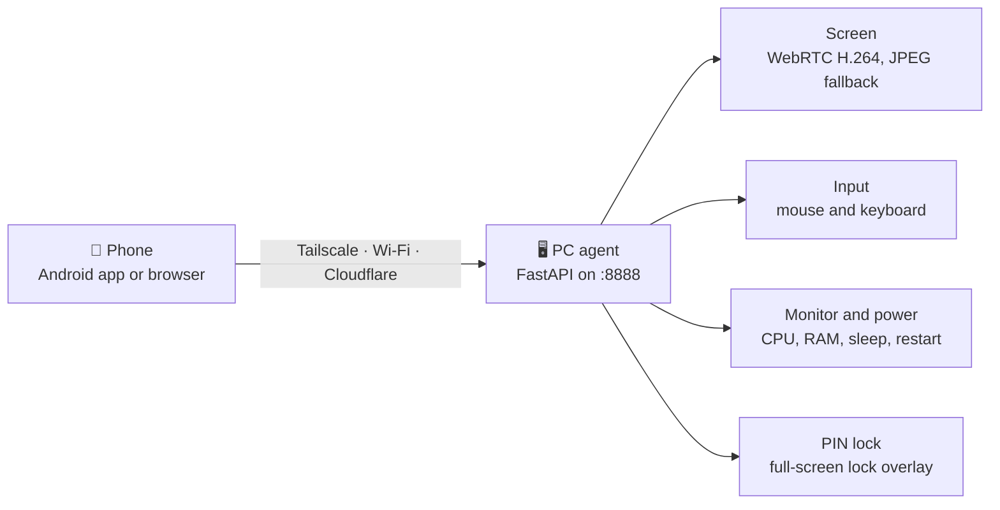

<div align="center">


# Remote PC Control

**See and control your own Windows PC from your phone.**<br>
Live screen · touch-as-mouse · keyboard · system monitor · power controls · PIN lock


[Features](#-features) ·
[Install and run](#-install-and-run) ·
[Connect](#-connect-your-phone) ·
[Android app](#-android-app) ·
[Configuration](#-configuration) ·
[Other commands](#-other-commands) ·
[PIN lock](#-pin-lock) ·
[Troubleshooting](#-troubleshooting) ·
[Security](#-security)

</div>

---

> [!WARNING]
> Use this only on a PC you own. Never port-forward port `8888` to the internet.

Remote PC Control runs a small server (the *agent*) on your Windows PC. Your phone reaches it through a private **Tailscale** network, your home Wi-Fi, or a **Cloudflare** tunnel, using a mobile browser or the native Android app.



## ✨ Features

| | Feature | What you get |
|---|---|---|
| 🖥 | **Live screen** | Android app: WebRTC (H.264 over UDP) first, JPEG over WebSocket as automatic fallback. Web dashboard: JPEG over WebSocket. Quality presets change live |
| 👆 | **Touch control** | Tap = click, long-press = right click, drag, scroll, double-click, fullscreen and landscape |
| 🖱 | **Trackpad (Android)** | Laptop-style pad: move, tap, double-tap, two-finger right click and scroll, tap-then-slide drag |
| ⌨ | **Keyboard** | Text box plus quick keys (Esc, Tab, arrows, Win, Alt+Tab, Ctrl+C/V/A/Z) |
| 📊 | **Monitor and power** | CPU, RAM, disk, network; lock, sleep, restart, shutdown (with confirmation) |
| 🔐 | **PIN lock** | Persistent full-screen lock that survives sleep and restarts |
| 🛡 | **Security** | Token-protected API and WebSockets, lockout after repeated wrong tokens |

## 🚀 Install and run

Run everything in **PowerShell on the Windows PC**, as your normal user, in the signed-in desktop session you want to control.

There are two ways to install. Pick **one**.

| | Option A · From source | Option B · Windows installer |
|---|---|---|
| Needs | Windows 10/11 x64, Python 3.11+ (3.12 recommended), Node.js 22, Git | Windows 10/11 x64 only |
| Terminal | Yes (commands below) | No |
| Best for | Full feature set, PIN lock screen, easy updates with `git pull` | Quick install, everything inside `RemotePCControl.exe` |

### Option A · From source (3 situations, 3 commands)

**① First time** — clones, installs dependencies, builds the dashboard, creates `.env` with a random token, then starts the server.

```powershell
cd $HOME
git clone https://github.com/mainnetwallet/remote-pc-control.git
cd remote-pc-control
Set-ExecutionPolicy -Scope Process Bypass
.\scripts\setup.ps1
.\scripts\start.ps1
```

Keep the `start.ps1` window open; the server listens on port **8888** (`Ctrl+C` stops it). Setup prints the token once. To see it again, copy only the value after `REMOTE_PC_TOKEN=`:

```powershell
Get-Content .env | Select-String '^REMOTE_PC_TOKEN='
```

**② A new commit arrived** — update and run the server again.

```powershell
cd $HOME\remote-pc-control
git pull
.\scripts\setup.ps1
.\scripts\start.ps1
```

`start.ps1` stops the old copy of the server by itself. `setup.ps1` reinstalls packages and rebuilds the dashboard only when `pyproject.toml` or the frontend changed (add `-Force` to redo everything). It adds settings that `.env.example` gained and never changes your token or existing values.

**③ The server is off** (closed window, reboot, `Ctrl+C`) — start it again.

```powershell
cd $HOME\remote-pc-control
.\scripts\start.ps1
```

> [!TIP]
> **If the agent starts at sign-in** (scheduled task `RemotePCControl`, see [Autostart](#-other-commands)), use these instead: for ② `Stop-ScheduledTask -TaskName RemotePCControl`, then `git pull`, `.\scripts\setup.ps1`, then `Start-ScheduledTask -TaskName RemotePCControl`; for ③ just `Start-ScheduledTask -TaskName RemotePCControl`. A manual `start.ps1` stops that task on purpose, so start the task again afterwards (or sign in again).

Check that it works on the PC: open `http://localhost:8888/api/health`; a healthy answer contains `"ok":true`.

### Option B · Windows installer (no terminal)

1. Download `RemotePCControl-Setup.exe` from the repository **Releases** page (one release per build, `build-<commit>`; it always holds both `RemotePCControl-Setup.exe` and `RemotePCControl-Android.apk`). You can also run **Actions → Windows installer** by hand.
2. Run it and accept the UAC prompt. The installer:
   - installs into `Program Files\RemotePCControl` and adds Start Menu and desktop shortcuts
   - registers the scheduled task `RemotePCControl` (starts the agent at sign-in with administrator rights, so input also works in Task Manager, Registry Editor and admin terminals)
   - adds the firewall rule `RemotePCControl Tailscale only` (TCP 8888 from `100.64.0.0/10`)
   - starts the agent right away
3. The **Remote PC Control app window** opens (English / বাংলা button at the top). It shows the **PC address and the access token** for the phone. Open it again any time from the shortcut. **Turn off server / Turn on server** at the top stops or starts the server without closing the window (closing the window leaves the server as it is).
4. From the window, with no terminal, you can: change the password, turn *Start with Windows* on or off, add or remove the Tailscale and Wi-Fi firewall rules, set a PIN and keep the lock screen running at sign-in, start a Cloudflare link (installs `cloudflared` for you), change screen and speed settings, read and clear logs, and restart or stop the agent. The panel opens **only on the PC itself** and also asks for the password.
5. To update, run the newer `RemotePCControl-Setup.exe` over the old one.

Files live in `%LOCALAPPDATA%\RemotePCControl\` (`.env`, `agent.log`). The installer's autostart and firewall step logs to `%ProgramData%\RemotePCControl\setup.log`. Uninstalling removes the tasks and the firewall rule.

**Built-in Tailscale (no Tailscale install on the PC):** app window → **Internet → Built-in Tailscale → Turn on**, open the sign-in link once, and log in with the same Tailscale account as the phone. The phone then uses `http://<address shown in the app>:8888`. Limit: screen video uses the WebSocket (JPEG) mode, because WebRTC cannot pass through the built-in node. The phone still needs the Tailscale app.

> [!NOTE]
> The packaged installer does not include the PIN lock screen (`lock_overlay.py`). Use Option A for that. Because the packaged agent runs as administrator, use a strong token.

## 🌐 Connect your phone

| Method | Best for | How |
|---|---|---|
| **Tailscale** | Private, stable, lowest latency | Same account on PC and phone, then open `http://<tailscale ip -4>:8888` |
| **Same Wi-Fi** | Home use | Allow port 8888 on the LAN, then open `http://<PC-IPv4>:8888` (`ipconfig` shows it) |
| **Cloudflare quick tunnel** | Anywhere, no account | `.\scripts\start-tunnel.ps1` in a second window, open the printed `https://….trycloudflare.com` link |
| **Cloudflare permanent tunnel** | Anywhere, fixed link | Free account and a domain, see below |

In the web page or app: enter the token, tap **Connect**, then **Start screen** and pick a mode.

| Mode | What your finger does |
|---|---|
| Click | Tap = left click, long-press = right click, drag moves the pointer (web: two fingers = scroll) |
| Drag | Drag holds the left button (select text, move windows) |
| Scroll | Drag up or down scrolls the page |

<details>
<summary><b>Tailscale and Wi-Fi (LAN) details</b></summary>

- **Tailscale:** the rule made by `setup.ps1` (`RemotePCControl Tailscale only`) accepts only Tailscale addresses (`100.64.0.0/10`). If setup warned that it could not create the rule, run `setup.ps1` once from an **Administrator PowerShell**.
- **LAN** (Administrator PowerShell). Limit the rule to the private profile and the local subnet:

  ```powershell
  New-NetFirewallRule -DisplayName "RemotePCControl LAN" -Direction Inbound -Action Allow -Protocol TCP -LocalPort 8888 -RemoteAddress LocalSubnet -Profile Private
  ```

  If Windows marks your Wi-Fi as *Public*, switch that network to *Private* instead of widening the rule. Remove the rule with `Remove-NetFirewallRule -DisplayName "RemotePCControl LAN"`.
- Give the PC a fixed address (DHCP reservation) so the URL does not change.

</details>

<details>
<summary><b>Cloudflare quick tunnel (no account, link changes every run)</b></summary>

Start the server first (`start.ps1`), then in a second window:

```powershell
cd $HOME\remote-pc-control
.\scripts\start-tunnel.ps1
```

The first run installs `cloudflared` with `winget`; if it asks, open a new PowerShell and run it again. Open the printed `https://….trycloudflare.com` link on the phone; test it first with `https://<your-link>/api/health`. `Ctrl+C` stops the tunnel. Do not share the link. A tunnel showing `502` means the server is not running.

**One command, link published for the Android app.** Let `start.ps1` start the tunnel and write the link to a **secret GitHub Gist** that the app reads:

1. Create a GitHub **classic** token with **only the `gist` scope** at <https://github.com/settings/tokens>. Never reuse a repository token.
2. Add to `.env` (`setup.ps1` also offers to save `GIST_TOKEN` for you):

   ```text
   QUICK_TUNNEL=1
   GIST_TOKEN=your-gist-token
   ```

3. Run `.\scripts\start.ps1`. It installs `cloudflared` if needed, starts the tunnel, prints the link and writes it to the Gist (the first run creates the Gist and appends `GIST_ID=<id>` to `.env`).
4. In the Android app enter `gist:<id>` once as the *PC URL*. The app then always finds the current link.

If the link cannot be read within about 40 seconds, `start.ps1` warns, points to `cloudflared.log`, and starts the server without the tunnel.

</details>

<details>
<summary><b>Cloudflare permanent tunnel (same link forever)</b></summary>

Needs a free Cloudflare account **and a domain** whose DNS is on Cloudflare (a domain costs about $10/year). The tunnel runs as a Windows service and starts with Windows; the server (`start.ps1` or the autostart task) must also be running.

1. **Domain.** <https://dash.cloudflare.com> → **Add a domain** → choose the **Free** plan → at your registrar replace the nameservers with the two Cloudflare gives you → wait until it shows **Active**. No domain yet? Buy one under **Domain Registration**, then do the same.
2. **Tunnel.** Dashboard → **Zero Trust** (first time: team name and Free plan) → **Networks → Tunnels** → **Create a tunnel** → **Cloudflared** → name it (e.g. `mypc`) → **Windows**.
3. In an **Administrator PowerShell** run exactly the command the dashboard shows (it contains a long token; treat it like a password):

   ```powershell
   winget install --id Cloudflare.cloudflared
   cloudflared.exe service install <LONG-TOKEN-FROM-DASHBOARD>
   ```

   If `cloudflared` is not recognised right after installing, open a new Administrator PowerShell. The connector should show **Connected**; click **Next**.
4. **Public hostname:** Subdomain `pc` (any name), Domain = yours, Path empty, **Type HTTP**, **URL `localhost:8888`** → Save.
5. On the phone open `https://pc.example.com` (your hostname) and enter the token. WebSockets work through the tunnel by default.

*Command-line alternative:*

```powershell
winget install --id Cloudflare.cloudflared
cloudflared tunnel login
cloudflared tunnel create mypc
cloudflared tunnel route dns mypc pc.example.com
```

Create `%USERPROFILE%\.cloudflared\config.yml`:

```yaml
tunnel: mypc
credentials-file: C:\Users\YOU\.cloudflared\<tunnel-id>.json
ingress:
  - hostname: pc.example.com
    service: http://localhost:8888
  - service: http_status:404
```

Test with `cloudflared tunnel run mypc`; run at startup with `cloudflared service install`. That service runs as SYSTEM and looks in `C:\Windows\System32\config\systemprofile\.cloudflared\`; if it does not start, copy `config.yml` and the `.json` there and fix `credentials-file`.

**Protect the link with Cloudflare Access (recommended).** Zero Trust → **Access → Applications → Add an application → Self-hosted** → domain = your hostname → policy **Allow**, rule **Emails** = only your email. Opening the link then asks for your email and a one-time code before the token screen. **Limit:** the Android app cannot complete that browser login, so with Access on only the browser works (use Tailscale or Wi-Fi for the app, or a *Service Token*, which the app does not send yet).

**Tunnel problems:** `502 Bad gateway` = server not running or service URL is not `http://localhost:8888`. Error 1033 = the service is down (`Get-Service cloudflared`, `Start-Service cloudflared`). Connector *Inactive* = PC offline or service stopped. To stop access: `Stop-Service cloudflared`, or delete the public hostname in the dashboard.

**বাংলা সারসংক্ষেপ (স্থায়ী লিংক):** (১) Cloudflare-এ domain যোগ করে **Active** হওয়া পর্যন্ত অপেক্ষা করুন। (২) Zero Trust > Networks > Tunnels > Create a tunnel > Cloudflared > Windows। (৩) Dashboard-এর `cloudflared.exe service install <token>` command **Administrator PowerShell**-এ চালান। (৪) Public hostname: subdomain `pc`, Type **HTTP**, URL **`localhost:8888`**। (৫) ফোনে `https://pc.আপনার-domain` খুলে token দিন; লিংক আর বদলাবে না। (৬) নিরাপত্তার জন্য Access থেকে শুধু আপনার email-কে অনুমতি দিন (Access চালু থাকলে Android app ব্লক হবে, শুধু browser চলবে)।

</details>

## 📱 Android app

1. Download the APK from **GitHub → Releases** (`RemotePCControl-Android.apk`) or **Actions → Android APK** (artifact `remote-pc-control-android-debug`). Allow installation from this source if Android asks.
2. Enter the *PC URL* (`http://100.x.x.x:8888`, a LAN address, `https://….trycloudflare.com`, or `gist:<id>`) and the token, then tap **Connect**. The URL and token are then stored encrypted (Android Keystore); **Log out** forgets them.

It is a personal-use debug build signed with the keystore in the repository (`android/app/debug.keystore`), so each build installs over the previous one; it is not a Play Store release.

| Screen | What it does |
|---|---|
| **Connect** | PC URL and token |
| **Dashboard** | CPU, memory and disk gauges, network speed, power buttons (Sleep, Restart, Shutdown ask for confirmation), PIN lock card, Quality setting |
| **Session** | Live screen, touch modes, trackpad, keys, a transport / resolution / fps overlay and a Rotate button |

| Quality preset | Width | Max FPS | WebRTC bitrate (upper limit) | JPEG quality |
|---|---|---|---|---|
| Low | 960 px | 20 | 1.5 Mbit/s | 45 |
| Medium (default) | 1280 px | 30 | 3 Mbit/s | 65 |
| High | 1920 px | 30 | 8 Mbit/s | 80 |
| Native | PC resolution | 30 | 20 Mbit/s | 90 |
| Ultra 60 | 1920 px | 60 | 12 Mbit/s | 80 |
| Ultra 120 | 1920 px | 120 | 16 Mbit/s | 80 |

The **Ultra** presets only reach their frame rate when the PC (capture + encoder), the link and the phone all keep up. Ultra 120 is WebRTC only (the JPEG fallback is limited to 60 fps). **Sharpest picture:** choose **Native** on the same Wi-Fi or over Tailscale; the WebSocket fallback then uses 4:4:4 colour and a Lanczos downscale (JPEG quality 85+), so coloured text and thin lines stay crisp. Bitrates are ceilings: the link's own estimate still lowers them. For exactly the chosen quality even on a slow link (at the cost of lag), add `REMOTE_PC_LATENCY_FIRST=0` to `.env`. The web dashboard has the same presets in a **Quality** menu (default High, JPEG stream only).

**Build it yourself.** Open `android/` in Android Studio (JDK 17, Android SDK 35) and choose **Build → Build APK(s)**, or run `gradle assembleDebug` inside `android/` (Gradle 8.11.1+; CI uses 8.13). The APK is written to `android/app/build/outputs/apk/debug/app-debug.apk`.

## ⚙ Configuration

Settings live in `.env` in the project folder (annotated template: [`.env.example`](.env.example)). Restart the server (`start.ps1`) after editing.

| Variable | Default | Meaning |
|---|---|---|
| `REMOTE_PC_TOKEN` | generated | Access password. **Required.** Minimum 4 characters, 12+ strongly recommended |
| `REMOTE_PC_HOST` / `REMOTE_PC_PORT` | `0.0.0.0` / `8888` | Listen address. Used by the packaged `RemotePCControl.exe` only: `start.ps1` always binds `0.0.0.0:8888` |
| `REMOTE_PC_WEBRTC` | `1` | WebRTC on or off (the WebSocket stream is the fallback) |
| `REMOTE_PC_RTC_FPS` | `auto` | WebRTC max fps: `auto` = monitor refresh rate (up to 120), or 1-120 |
| `REMOTE_PC_RTC_BITRATE` | `4000` | Starting WebRTC bitrate limit in kbit/s (300-30000); the app's quality preset replaces it for its session |
| `REMOTE_PC_RTC_ENCODER` | `auto` | `auto`, `nvenc`, `qsv`, `amf` or `x264` (libx264 is always the last resort) |
| `REMOTE_PC_STUN_URL` | Google STUN | STUN server(s), comma separated |
| `REMOTE_PC_TURN_URL` / `_USER` / `_PASS` | empty | Optional TURN relay for networks without a direct path |
| `REMOTE_PC_FPS` | `auto` | Starting frame rate of the WebSocket stream (1-60) |
| `REMOTE_PC_JPEG_QUALITY` | `55` | Starting JPEG quality of the WebSocket stream (25-85) |
| `REMOTE_PC_MAX_WIDTH` | `1280` | Starting width limit of the WebSocket stream (`0` = native) |
| `REMOTE_PC_LATENCY_FIRST` | `1` | Shrink the picture on slow links to keep delay low (`0` = always the chosen quality) |
| `REMOTE_PC_MOTION_QUALITY` / `_WIDTH` | `100` / `100` | While the picture moves, send frames at this percent of JPEG quality (40-100) / width (50-100); `100` = off. A full-quality frame follows when it rests |
| `REMOTE_PC_CAPTURE` | `auto` | `mss` forces the classic capture (default uses `dxcam` when available) |
| `REMOTE_PC_SHOW_CURSOR` | `1` | Draw a pointer on the stream |
| `REMOTE_PC_LOCK_BUTTON` | `pin` | `windows` makes the app's Lock button always use the Windows lock |
| `REMOTE_PC_LOCK_STATE` | `lock_state.json` | Path of the PIN-lock state file |
| `QUICK_TUNNEL` / `GIST_TOKEN` / `GIST_ID` | empty | Read by `start.ps1` only: quick tunnel plus link published to a secret Gist |

**Which network gives low latency?** Same Wi-Fi and Tailscale give direct UDP (about 50 ms or less). A free Cloudflare quick tunnel only carries TCP, so WebRTC usually falls back to the WebSocket stream. Behind CGNAT or a strict firewall you need a TURN relay.

<details>
<summary><b>TURN relay (only if the direct connection fails)</b></summary>

You need a small server with a public IP and open UDP port 3478. With [coturn](https://github.com/coturn/coturn) a minimal `turnserver.conf` is:

```text
listening-port=3478
realm=remote-pc
lt-cred-mech
user=pcuser:use-a-long-random-password
fingerprint
no-cli
```

Then add to the PC's `.env` and restart:

```text
REMOTE_PC_TURN_URL=turn:YOUR.SERVER.IP:3478
REMOTE_PC_TURN_USER=pcuser
REMOTE_PC_TURN_PASS=use-a-long-random-password
```

The PC hands the TURN details only to clients that signed in with the token and never logs them. Use a dedicated TURN user.

</details>

**Check which transport is active.** Android: the corner label starts with `WebRTC · …` or `WebSocket · …`. PC: the `start.ps1` window logs `WebRTC connection connected` (and the encoder in use) for each WebRTC session. The web dashboard always uses the JPEG WebSocket stream. Protocol details for other clients are in [docs/ARCHITECTURE.md](docs/ARCHITECTURE.md#webrtc-and-stream-protocol).

## 🧰 Other commands

Run from `$HOME\remote-pc-control` in PowerShell. Only needed when you want the feature. Each block has its own copy button.

**Show the access token**

```powershell
Get-Content .env | Select-String '^REMOTE_PC_TOKEN='
```

**Change the password** (asks for it; min 4 characters, no spaces; then restart the server)

```powershell
.\scripts\set-password.ps1
```

**Start the agent hidden at sign-in / remove it**

```powershell
.\scripts\install-autostart.ps1
```

```powershell
.\scripts\install-autostart.ps1 -Remove
```

**Stop / start the autostart task**

```powershell
Stop-ScheduledTask -TaskName RemotePCControl
```

```powershell
Start-ScheduledTask -TaskName RemotePCControl
```

**Control elevated windows** (Task Manager, Registry Editor, admin terminals). Run once in an **Administrator PowerShell**. It gives the agent full admin rights, so use a strong password; the UAC secure desktop still cannot be controlled.

```powershell
.\scripts\install-autostart.ps1 -Admin
Start-ScheduledTask -TaskName RemotePCControl
```

**Set the PC-side PIN, and install the PIN lock screen at sign-in** (remove it with `-Remove`)

```powershell
.\scripts\set-pin.ps1
```

```powershell
.\scripts\install-lock-overlay.ps1
```

**Start a quick Cloudflare tunnel** (server must be running)

```powershell
.\scripts\start-tunnel.ps1
```

**Remove the Tailscale firewall rule** (Administrator PowerShell)

```powershell
.\scripts\remove-firewall.ps1
```

**Reinstall everything from scratch**

```powershell
.\scripts\setup.ps1 -Force
```

**What FPS can my PC do?** (`--apply` writes the recommended values into `.env`)

```powershell
python tools\pc_capability.py
```

```powershell
python tools\pc_capability.py --apply
```

**Run backend tests**

```powershell
.\.venv\Scripts\python.exe -m pytest backend/tests tests -q
```

**Build the dashboard by hand**

```powershell
cd frontend
npm install
npm run build
```

**Autostart details.** The task `RemotePCControl` starts the agent hidden 10 seconds after **your user signs in** (screen capture and input need that session, so it cannot run before sign-in). The runner waits for the network and restarts the server 10 seconds after it exits. Logs are in the project folder: `autostart.log`, `server.out.log`, `server.err.log` (a log over 1 MB is deleted at the next runner start). Stopping only the python process makes the runner restart it; use `Stop-ScheduledTask` to really stop it.

<details>
<summary><b>Reset <code>.env</code> to the latest template</b> (⚠ overwrites password, Gist and TURN settings)</summary>

```powershell
Copy-Item .env .env.backup
Copy-Item .env.example .env -Force
.\scripts\set-password.ps1 YourNewPassword
```

Copy back any values you still need from `.env.backup`, then delete the backup. Normal updates never require this.

</details>

## 🔐 PIN lock

A separate, persistent lock screen for the PC itself. It is **not** Windows' `Win+L` lock.

- **Set a PIN** (4-12 digits) from the Android app (PIN lock card → Set PIN) or with `.\scripts\set-pin.ps1`.
- **Lock** from the app at any time. It stays locked through sleep, restart and shutdown until someone unlocks it.
- **Unlock** from the app (your token already proves who you are) or at the PC with the PIN. Five wrong PINs trigger a 60-second cool-down.
- Nothing locks or unlocks on a timer. State lives in `lock_state.json` (git-ignored); the lock screen reads it directly, so it works even when the server is not running.

> [!IMPORTANT]
> Once a PIN is set, the app's **Lock** power button uses this PIN lock instead of the Windows lock, because the Windows sign-in screen cannot be streamed or clicked remotely. That only works if the lock screen process is installed. Without it, "Lock" sets the state but nothing appears. To keep the Windows lock on that button, add `REMOTE_PC_LOCK_BUTTON=windows` to `.env`.

**Enable the lock screen at sign-in** (once, source install):

```powershell
cd $HOME\remote-pc-control
.\scripts\set-pin.ps1
.\scripts\install-lock-overlay.ps1
```

This registers one scheduled task, `RemotePCControlLock`, which runs `lock_overlay.py` as your user (re-running never creates a second task; start it now with `Start-ScheduledTask RemotePCControlLock`). Diagnostics (never the PIN or token) go to `%LOCALAPPDATA%\RemotePCControl\lock_overlay.log`.

**Limits, stated plainly.** This is an app-level window, not the Windows sign-in screen. It blocks Win, Alt+Tab, Alt+Esc and Ctrl+Esc while showing, but **Ctrl+Alt+Delete cannot be intercepted by any ordinary application**. Treat it as a privacy screen for casual access, not a replacement for your Windows account password.

<details>
<summary><b>Manual test checklist (real Windows 11 PC)</b></summary>

Automated tests (`backend/tests/test_lock_overlay.py`) cover the overlay logic, but not physical keyboard input, focus stealing, the low-level keyboard hook, the named mutex or the scheduled task. Check these by hand after `setup.ps1`, `set-pin.ps1`, `install-lock-overlay.ps1`:

| # | Step | Expected |
|---|---|---|
| 1 | Lock from the app | Full-screen PIN screen within ~1 s |
| 2 | Type digits (main keyboard and numeric keypad) without clicking | Dots appear, once per key press |
| 3 | Backspace, retype, Ctrl+A overwrite; type letters | Digits edit correctly; letters ignored; focus never jumps |
| 4 | Wrong PIN, then 5 wrong PINs | "Wrong PIN (n attempts left)"; then a cool-down that rejects even the right PIN |
| 5 | Correct PIN (Enter, keypad Enter, or mouse + Unlock button) | Unlocks once, screen closes |
| 6 | While locked: Alt+Tab, Win, Ctrl+Esc, Ctrl+Shift+Esc | Blocked; work normally after unlock (Win opens Start again) |
| 7 | While locked: start a program that grabs focus | Typing returns to the PIN field, no flicker loop |
| 8 | Ctrl+Alt+Delete while locked | Windows' secure screen opens (cannot be blocked; expected) |
| 9 | Run `pythonw.exe lock_overlay.py` by hand while locked; run `install-lock-overlay.ps1` twice | No second window; exactly one overlay process and one task |
| 10 | End the overlay in Task Manager while locked | It returns within ~1 min, still locked |
| 11 | Lock from the app, stop the server | Overlay stays; PIN still unlocks |
| 12 | Lock, then Unlock from the app; close the app while unlocked | Overlay closes within ~1 s; PC never locks by itself |
| 13 | With a PIN set, tap **Lock**; then try `REMOTE_PC_LOCK_BUTTON=windows` and restart the server | PIN screen (mode `pin`); then the Windows lock screen. Remove the setting afterwards |
| 14 | Lock + restart, sign in; unlock + restart, sign in; same with shutdown | Locked screen appears only if locked before |

</details>

## 🩺 Troubleshooting

| Symptom | Fix |
|---|---|
| `python` or `npm` not found | Install Python 3.11+ and Node.js 22, then open a new PowerShell |
| `git clone` says the folder exists | `cd $HOME\remote-pc-control`, then use command ② |
| Token rejected | Copy the full `REMOTE_PC_TOKEN` from `.env`; check it is not the placeholder `replace-with-your-password` |
| Page or app cannot connect | Server running? Right URL and port 8888? Phone's Tailscale on and signed in to the same account? Windows Firewall rule present? |
| Port 8888 already in use | Run `start.ps1` again: it stops an older copy of this server (and the `RemotePCControl` task) by itself, but refuses to touch any other program using the port |
| Autostart did not come back after a manual `start.ps1` | `start.ps1` stopped the task on purpose. Run `Start-ScheduledTask -TaskName RemotePCControl` or sign in again |
| Tunnel shows 502 / new link not reachable yet | `start.ps1` is not running; for a new quick-tunnel link wait 1-2 minutes |
| Black screen / stream error | The PC is locked or a UAC prompt is open; unlock the desktop |
| Clicks or keys do nothing in Task Manager, Registry Editor or an admin terminal | Windows blocks input into elevated windows. Run `.\scripts\install-autostart.ps1 -Admin` from an Administrator PowerShell |
| "Too many failed attempts" / HTTP 429 | One client is locked out for 5 minutes after 8 wrong tokens; a global guard blocks all logins for 10 minutes after 40 wrong tokens from anyone. Wait, then use the correct token |
| HTTP 429 "Too many failed requests" | The same request failed 10 times in a minute from your address (or 60 failed requests of any kind). Fix the cause (token, URL), then wait for the `Retry-After` seconds shown in the response |
| App always shows "WebSocket" | No direct UDP path; use Tailscale or the same Wi-Fi, or set up TURN. Check `REMOTE_PC_WEBRTC=1` |
| `aiortc is not installed` | `.\scripts\setup.ps1 -Force`, then restart `start.ps1` |
| Lock button does nothing visible | A PIN is set but the lock screen is not installed or running: `.\scripts\install-lock-overlay.ps1`, or set `REMOTE_PC_LOCK_BUTTON=windows` |

## 🔒 Security

- Anyone with the token and a reachable URL can control the PC. Keep both private, and revoke any token or password you ever pasted into a chat or an issue.
- **Rate limits (built in):** 8 wrong tokens in 5 minutes lock a client out for the rest of the window; 40 wrong tokens from anyone block all logins for 10 minutes. On top of that, the *same request failing again and again* (wrong or missing token, wrong path, rejected body) is answered with HTTP 429 and a `Retry-After` header after 10 failures per minute from one address, and a client with 60 failed requests of any kind per minute (a scanner) waits out the minute. A garbled or silent WebSocket login counts as a failed login. A successful request clears the counter for that route.
- Prefer Tailscale or Cloudflare Access over a bare public link. Never expose port 8888 directly.
- The agent runs in the logged-in desktop session. It cannot capture or control the Windows sign-in screen or UAC prompts and does not bypass Windows authentication.
- `GIST_TOKEN` must be a GitHub *classic* token with **only the `gist` scope**. Never reuse a repository token.
- Wake-on-LAN over mobile data needs a separately authenticated, always-on LAN relay (the API reports it as not configured).
- Never commit `.env` or `lock_state.json`; both are git-ignored.
- **Report a vulnerability** privately via the GitHub Security tab ("Report a vulnerability"), not a public issue. Include what you did, what you expected, what happened and the commit hash.

## 🛠 Project layout

```text
backend/     FastAPI server (screen.py, webrtc.py, webrtc_encoder.py, pinlock.py)
frontend/    React web dashboard (touch UI: src/RemoteScreen.tsx)
android/     Native Android app (Kotlin, Jetpack Compose, Material 3)
scripts/     setup, start, tunnel, autostart, lock-screen and firewall scripts
installer/   Windows installer definition (Inno Setup)
tools/       Wake-on-LAN sender and pc_capability.py
docs/        ARCHITECTURE.md: code map, API routes, protocol, tests, build pipeline
lock_overlay.py   Full-screen PIN lock process
```

Code map, API routes, WebRTC protocol, tests and CI: [docs/ARCHITECTURE.md](docs/ARCHITECTURE.md).
