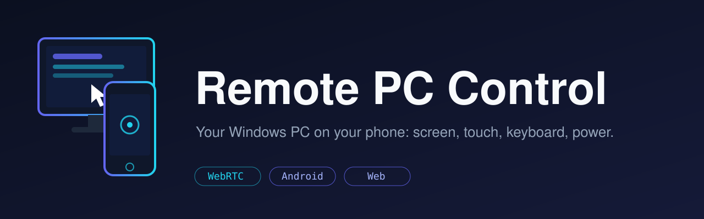

<div align="center">



**See and control your own Windows PC from your phone: live screen, touch-as-mouse, keyboard, system monitor and power controls.**


[Features](#-features) • [Quick Start](#-quick-start) • [Commands](#-command-reference) • [Connect](#-connect-your-phone) • [Android App](#-android-app) • [Configuration](#-configuration) • [Troubleshooting](#-troubleshooting) • [Security](#-security)

</div>

---

> ⚠ Use it only on a PC you own. Never port-forward port `8888` to the internet.

Works from anywhere through a private **Tailscale** network or a **Cloudflare** tunnel, from a phone browser or the Android app.

## ✨ Features

| | Feature | Description |
|---|---|---|
| 🖥 | **Live screen** | WebRTC (H.264 over UDP) first, JPEG-over-WebSocket as automatic fallback; quality changes live |
| 👆 | **Touch control** | Tap = click, long-press = right click, drag, scroll, double-click, fullscreen/landscape |
| 🖱 | **Trackpad (Android)** | Laptop-style pad: move, tap, double-tap, two-finger right click/scroll, tap-then-slide drag |
| ⌨ | **Keyboard** | Text box plus quick keys (Esc, Tab, arrows, Win, Alt+Tab, Ctrl+C/V/A/Z) |
| 📊 | **Monitor & power** | CPU/RAM/disk/network, lock, sleep, restart, shutdown (with confirmation) |
| 🔒 | **Security** | Token-protected API and WebSockets, 5-minute lockout after 8 wrong tokens |
| 📱 | **Clients** | Mobile web dashboard and native Android app (Material 3 dark UI) |

## 🚀 Quick Start

Run in **PowerShell on the Windows PC**. Prerequisites: **Python 3.12 (x64)**, **Node.js 22**, **Git**.

**1. First-time setup** (installs dependencies, builds dashboard, creates `.env`)

```powershell
cd $HOME
git clone https://github.com/mainnetwallet/remote-pc-control.git
cd remote-pc-control
Set-ExecutionPolicy -Scope Process Bypass
.\scripts\setup.ps1
```

**2. Show the access token** (copy only the value after `REMOTE_PC_TOKEN=`)

```powershell
cd $HOME\remote-pc-control
Get-Content .env | Select-String REMOTE_PC_TOKEN
```

**3. Start the server** (keep this window open, port 8888)

```powershell
cd $HOME\remote-pc-control
.\scripts\start.ps1
```

Step-by-step guides: [Windows quick start](docs/QUICKSTART_WINDOWS.md) · [Install and autostart](INSTALL_WINDOWS.md)

## 🧰 Command reference

**Update the project**

```powershell
cd $HOME\remote-pc-control
git checkout main
git pull
.\scripts\setup.ps1
```

**Update and restart the scheduled-task installation** (`RemotePCControl`)

```powershell
cd $HOME\remote-pc-control
Stop-ScheduledTask -TaskName RemotePCControl
git pull
.\scripts\setup.ps1
Start-ScheduledTask -TaskName RemotePCControl
```

**Run backend tests**

```powershell
cd $HOME\remote-pc-control
.\.venv\Scripts\python.exe -m pytest backend/tests tests -q
```

**Build the dashboard**

```powershell
cd $HOME\remote-pc-control\frontend
npm install
npm run build
```

**Reset `.env` to the latest template** (⚠ overwrites password, Gist and TURN settings; run only when needed)

```powershell
cd $HOME\remote-pc-control
Copy-Item .env .env.backup
Copy-Item .env.example .env -Force
.\scripts\set-password.ps1 YourNewPassword
```

`setup.ps1` only *adds* new settings to an existing `.env`. After a reset, restore values you still need from the backup and securely delete it.

## 🌐 Connect your phone

| Method | Best for | How |
|---|---|---|
| **Cloudflare quick tunnel** | Anywhere, no account | `.\scripts\start-tunnel.ps1` in a second window, open the printed `https://….trycloudflare.com` link |
| **Tailscale** | Private, stable, lowest latency | Same account on PC and phone, then open `http://<tailscale ip -4>:8888` |
| **Same Wi-Fi** | Home use | Allow port 8888 on the LAN, open `http://<PC-IPv4>:8888` |

**Start the Cloudflare tunnel** (second PowerShell window)

```powershell
cd $HOME\remote-pc-control
.\scripts\start-tunnel.ps1
```

<details>
<summary><b>Cloudflare quick tunnel details</b></summary>

- Test first: `https://<your-link>/api/health` should return `{"ok":true,...}`.
- The link changes every time the tunnel restarts. Keep both windows open; `Ctrl+C` stops the tunnel. Do not share the link.
- Permanent link and login protection: [docs/CLOUDFLARE.md](docs/CLOUDFLARE.md).

**One command with automatic link for the Android app:** add to `.env`:

```
QUICK_TUNNEL=1
GIST_TOKEN=your-gist-token
```

`GIST_TOKEN` is a GitHub *classic* token with **only the `gist` scope** (never reuse a repo token). Run `.\scripts\start.ps1`; it starts the tunnel and writes the current link to a secret Gist. Enter `gist:<id>` once as *PC URL* in the Android app and it always finds the current link.
</details>

<details>
<summary><b>Tailscale and LAN details</b></summary>

- **Tailscale:** the firewall rule from `setup.ps1` only accepts Tailscale addresses (`100.64.0.0/10`). Run `setup.ps1` from an administrator PowerShell if the rule could not be created.
- **LAN** (administrator PowerShell):

```powershell
New-NetFirewallRule -DisplayName "RemotePCControl LAN" -Direction Inbound -Action Allow -Protocol TCP -LocalPort 8888 -RemoteAddress LocalSubnet -Profile Any
ipconfig
```

Give the PC a fixed address (DHCP reservation) so the URL does not change.
</details>

**Use it:** enter the token, tap **Connect**, then **Start screen** and pick a mode:

| Mode | What your finger does |
|---|---|
| Click | tap = left click, long-press = right click, drag moves the pointer (web: two fingers = scroll) |
| Drag | drag holds the left button (select text, move windows) |
| Scroll | drag up/down scrolls the page |

## 📱 Android app

Open **GitHub → Actions → Android APK** (or *Run workflow*), download the APK from the artifact or **Releases**, and install it. Enter the *PC URL* (`https://….trycloudflare.com`, `http://100.x.x.x:8888`, LAN address or `gist:<id>`) and the token. Personal-use debug build, not a Play Store release. Build details: [android/README.md](android/README.md).

- **Connect:** PC URL and token; the URL and password (Android Keystore encrypted) are remembered until Log out.
- **Dashboard:** CPU, memory, disk gauges, network speed, power buttons (Sleep, Restart, Shutdown ask for confirmation), Quality setting.
- **Session:** live screen, touch modes, trackpad, keys, a transport/resolution/fps overlay and a Rotate button.

| Quality | Width | Max FPS | WebRTC bitrate | JPEG quality |
|---|---|---|---|---|
| Low | 960 px | 20 | 1.5 Mbit/s | 45 |
| Medium (default) | 1280 px | 30 | 3 Mbit/s | 65 |
| High | 1920 px | 30 | 6 Mbit/s | 78 |
| Native | PC resolution | 20 | 10 Mbit/s | 85 |

## ⚙ Configuration

Settings live in `.env` (restart `start.ps1` after editing). Full template: [`.env.example`](.env.example).

| Variable | Default | Meaning |
|---|---|---|
| `REMOTE_PC_TOKEN` | generated | Access password (12+ characters recommended). Required |
| `REMOTE_PC_HOST` / `REMOTE_PC_PORT` | `0.0.0.0` / `8888` | Listen address |
| `REMOTE_PC_WEBRTC` | `1` | WebRTC on/off (WebSocket stream is the fallback) |
| `REMOTE_PC_RTC_FPS` / `REMOTE_PC_RTC_BITRATE` | `30` / `4000` | WebRTC max fps and bitrate limit (kbit/s) |
| `REMOTE_PC_RTC_ENCODER` | `auto` | `auto`, `nvenc`, `qsv`, `amf` or `x264` |
| `REMOTE_PC_STUN_URL` | Google STUN | STUN server(s), comma separated |
| `REMOTE_PC_TURN_URL` / `_USER` / `_PASS` | empty | Optional TURN relay for networks without a direct path |
| `REMOTE_PC_FPS` / `_JPEG_QUALITY` / `_MAX_WIDTH` | `20` / `55` / `1280` | Starting values of the WebSocket stream |
| `REMOTE_PC_LATENCY_FIRST` | `1` | Shrink the picture on slow links to keep delay low |
| `REMOTE_PC_CAPTURE` | `auto` | `mss` forces the classic capture (default uses `dxcam` when available) |
| `REMOTE_PC_SHOW_CURSOR` | `1` | Draw a pointer on the stream |

**Which network gives low latency?** Same Wi-Fi and Tailscale give direct UDP (about 50 ms or less). A free Cloudflare quick tunnel only carries TCP, so WebRTC usually falls back to the WebSocket stream; use Tailscale, the same LAN or a TURN relay for the best result.

Full WebRTC, stream-quality, TURN and protocol reference: **[docs/WEBRTC.md](docs/WEBRTC.md)**.

## 🩺 Troubleshooting

| Symptom | Fix |
|---|---|
| Page does not open (Tailscale) | Phone's Tailscale must be on and on the same account |
| Port 8888 already in use | `start.ps1` now stops the old server (and the `RemotePCControl` task) by itself; just run it again |
| Tunnel shows 502 / bad gateway | `start.ps1` is not running; start it in its own window |
| New tunnel link not reachable yet | Wait 1-2 minutes and retry |
| Black screen / stream error | PC is locked or a UAC prompt is open; unlock the desktop |
| Clicks/keys do nothing in Task Manager, Registry Editor or an admin terminal | Windows blocks input from a normal process into elevated windows. From an Administrator PowerShell run `.\scripts\install-autostart.ps1 -Admin` (or start `start.ps1` as administrator) |
| `python` or `npm` not found | Install Python 3.12 and Node.js 22, then open a new PowerShell |
| "Too many failed attempts" | Wait 5 minutes and use the correct token |
| App always shows "WebSocket" | No direct UDP path; use Tailscale or the same Wi-Fi, or set up TURN. Check `REMOTE_PC_WEBRTC=1` |
| `aiortc is not installed` | Run `.\scripts\setup.ps1 -Force`, then restart `start.ps1` |
| `git clone` says folder exists | `cd $HOME\remote-pc-control`, then `git pull` |

## 🔒 Security

- Anyone with the token and a reachable URL can control the PC. Keep both private and revoke any credential pasted into chats or tickets.
- Prefer Tailscale or Cloudflare Access ([docs/CLOUDFLARE.md](docs/CLOUDFLARE.md)) over a bare public link. Never expose port 8888 directly.
- The agent runs in the logged-in desktop session. It cannot capture or control the Windows sign-in screen or UAC prompts and does not bypass Windows authentication.
- Wake-on-LAN over mobile data needs a separately authenticated always-on LAN relay (reported as not configured).
- Never commit `.env`.

## 🛠 Development

```text
backend/    FastAPI server (screen.py, webrtc.py, webrtc_encoder.py)
frontend/   React web dashboard (touch UI: src/RemoteScreen.tsx)
android/    Native Android app (Kotlin, Material 3)
scripts/    setup, start, tunnel, autostart, firewall scripts
installer/  Windows installer (Inno Setup)
docs/       Quick start, Cloudflare, WebRTC, architecture
```

Code map, API routes, tests and build pipeline: [docs/ARCHITECTURE.md](docs/ARCHITECTURE.md).

## 📚 Documentation

[Windows quick start](docs/QUICKSTART_WINDOWS.md) · [Install and autostart](INSTALL_WINDOWS.md) · [Cloudflare Tunnel and Access](docs/CLOUDFLARE.md) · [WebRTC and stream details](docs/WEBRTC.md) · [Android app](android/README.md) · [Architecture](docs/ARCHITECTURE.md)
