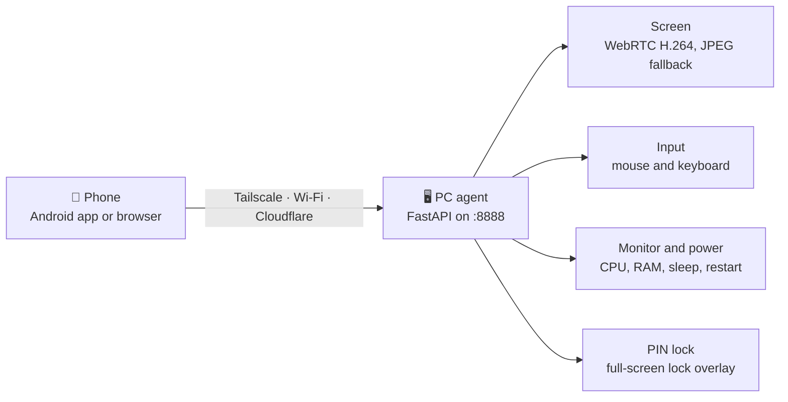

<div align="center">


# Remote PC Control

**See and control your own Windows PC from your phone.**<br>
Live screen · touch-as-mouse · keyboard · system monitor · power controls · PIN lock


[Features](#-features) ·
[Quick start](#-quick-start) ·
[Connect](#-connect-your-phone) ·
[Android app](#-android-app) ·
[Configuration](#-configuration) ·
[Commands](#-command-reference) ·
[PIN lock](#-pin-lock) ·
[Troubleshooting](#-troubleshooting) ·
[Security](#-security)

</div>

---

> [!WARNING]
> Use this only on a PC you own. Never port-forward port `8888` to the internet.

Remote PC Control runs a small server (the *agent*) on your Windows PC. Your phone reaches it through a private **Tailscale** network, your home Wi-Fi, or a **Cloudflare** tunnel, using either a mobile browser or the native Android app.



## ✨ Features

| | Feature | What you get |
|---|---|---|
| 🖥 | **Live screen** | WebRTC (H.264 over UDP) first, JPEG over WebSocket as automatic fallback; quality changes live |
| 👆 | **Touch control** | Tap = click, long-press = right click, drag, scroll, double-click, fullscreen and landscape |
| 🖱 | **Trackpad (Android)** | Laptop-style pad: move, tap, double-tap, two-finger right click and scroll, tap-then-slide drag |
| ⌨ | **Keyboard** | Text box plus quick keys (Esc, Tab, arrows, Win, Alt+Tab, Ctrl+C/V/A/Z) |
| 📊 | **Monitor and power** | CPU, RAM, disk, network; lock, sleep, restart, shutdown (with confirmation) |
| 🔐 | **PIN lock** | Persistent full-screen lock that survives sleep and restarts; unlock from the app or with the PIN |
| 🛡 | **Security** | Token-protected API and WebSockets, lockout after repeated wrong tokens |
| 📱 | **Clients** | Mobile web dashboard and native Android app (Material 3 dark UI) |

## 🚀 Quick start

Run everything in **PowerShell on the Windows PC**.

| Requirement | Version |
|---|---|
| Windows | 10 or 11, x64 |
| Python | 3.11+ x64 (3.12 recommended) |
| Node.js | 22 |
| Git | any recent version |

**1 · Install** (creates `.venv`, installs dependencies, builds the dashboard, creates `.env`)

```powershell
cd $HOME
git clone https://github.com/mainnetwallet/remote-pc-control.git
cd remote-pc-control
Set-ExecutionPolicy -Scope Process Bypass
.\scripts\setup.ps1
```

**2 · Show the access token** (copy only the value after `REMOTE_PC_TOKEN=`)

```powershell
Get-Content .env | Select-String '^REMOTE_PC_TOKEN='
```

**3 · Start the server** (keep this window open; it listens on port 8888)

```powershell
.\scripts\start.ps1
```

> [!TIP]
> Prefer the packaged installer, or want the server to start at sign-in? See [Install and autostart](INSTALL_WINDOWS.md). A step-by-step walkthrough with health checks is in the [Windows quick start](docs/QUICKSTART_WINDOWS.md).

## 🌐 Connect your phone

| Method | Best for | How |
|---|---|---|
| **Tailscale** | Private, stable, lowest latency | Same account on PC and phone, then open `http://<tailscale ip -4>:8888` |
| **Same Wi-Fi** | Home use | Allow port 8888 on the LAN, then open `http://<PC-IPv4>:8888` |
| **Cloudflare quick tunnel** | Anywhere, no account | `.\scripts\start-tunnel.ps1` in a second window, open the printed `https://….trycloudflare.com` link |
| **Cloudflare permanent tunnel** | Anywhere, fixed link | Needs a free account and a domain: [docs/CLOUDFLARE.md](docs/CLOUDFLARE.md) |

<details>
<summary><b>Tailscale and LAN details</b></summary>

- **Tailscale:** the firewall rule created by `setup.ps1` (`RemotePCControl Tailscale only`) accepts only Tailscale addresses (`100.64.0.0/10`). Run `setup.ps1` from an Administrator PowerShell if it printed a warning that the rule could not be created.
- **LAN** (Administrator PowerShell). Limit the rule to the private profile and the local subnet:

  ```powershell
  New-NetFirewallRule -DisplayName "RemotePCControl LAN" -Direction Inbound -Action Allow -Protocol TCP -LocalPort 8888 -RemoteAddress LocalSubnet -Profile Private
  ipconfig
  ```

  If Windows marks your Wi-Fi as *Public*, switch that network to *Private* in Windows settings rather than widening the rule to every profile.
- Give the PC a fixed address (DHCP reservation) so the URL does not change.

</details>

<details>
<summary><b>Cloudflare quick tunnel details</b></summary>

- Start it in a second window with `.\scripts\start-tunnel.ps1`. Test first: `https://<your-link>/api/health` returns `{"ok":true,...}`.
- The link changes every time the tunnel restarts. `Ctrl+C` stops the tunnel. Do not share the link.
- One command, link published automatically for the Android app (`QUICK_TUNNEL=1` plus a Gist token): see [docs/CLOUDFLARE.md](docs/CLOUDFLARE.md#a2--one-command-start-with-an-automatic-link-for-the-android-app).

</details>

**Using the screen:** enter the token, tap **Connect**, then **Start screen** and pick a mode.

| Mode | What your finger does |
|---|---|
| Click | Tap = left click, long-press = right click, drag moves the pointer (web: two fingers = scroll) |
| Drag | Drag holds the left button (select text, move windows) |
| Scroll | Drag up or down scrolls the page |

## 📱 Android app

1. Open **GitHub → Actions → Android APK** (or *Run workflow*), or the repository **Releases** page.
2. Download the APK (artifact `remote-pc-control-android-debug`, or the release asset) and install it.
3. Enter the *PC URL* (`https://….trycloudflare.com`, `http://100.x.x.x:8888`, a LAN address, or `gist:<id>`) and the token.

It is a personal-use debug build, not a Play Store release. Build details: [android/README.md](android/README.md).

| Screen | What it does |
|---|---|
| **Connect** | PC URL and token. Both are remembered (encrypted with the Android Keystore) until you tap Log out |
| **Dashboard** | CPU, memory and disk gauges, network speed, power buttons (Sleep, Restart, Shutdown ask for confirmation), PIN lock card, Quality setting |
| **Session** | Live screen, touch modes, trackpad, keys, a transport / resolution / fps overlay and a Rotate button |

| Quality preset | Width | Max FPS | WebRTC bitrate | JPEG quality |
|---|---|---|---|---|
| Low | 960 px | 20 | 1.5 Mbit/s | 45 |
| Medium (default) | 1280 px | 30 | 3 Mbit/s | 65 |
| High | 1920 px | 30 | 6 Mbit/s | 78 |
| Native | PC resolution | 20 | 10 Mbit/s | 85 |

## ⚙ Configuration

Settings live in `.env` in the project folder. Restart `start.ps1` after editing. The annotated template is [`.env.example`](.env.example).

| Variable | Default | Meaning |
|---|---|---|
| `REMOTE_PC_TOKEN` | generated | Access password. **Required.** Minimum 4 characters, 12+ strongly recommended |
| `REMOTE_PC_HOST` / `REMOTE_PC_PORT` | `127.0.0.1` in code, `0.0.0.0` / `8888` in `.env.example` | Listen address. Used by the packaged `RemotePCControl.exe` only (see note below) |
| `REMOTE_PC_WEBRTC` | `1` | WebRTC on or off (the WebSocket stream is the fallback) |
| `REMOTE_PC_RTC_FPS` | `30` | WebRTC max frames per second (1-30) |
| `REMOTE_PC_RTC_BITRATE` | `4000` | WebRTC bitrate limit in kbit/s (300-30000) |
| `REMOTE_PC_RTC_ENCODER` | `auto` | `auto`, `nvenc`, `qsv`, `amf` or `x264` |
| `REMOTE_PC_STUN_URL` | Google STUN | STUN server(s), comma separated |
| `REMOTE_PC_TURN_URL` / `_USER` / `_PASS` | empty | Optional TURN relay for networks without a direct path |
| `REMOTE_PC_FPS` | `20` | Starting frame rate of the WebSocket stream (1-30) |
| `REMOTE_PC_JPEG_QUALITY` | `55` | Starting JPEG quality of the WebSocket stream (25-85) |
| `REMOTE_PC_MAX_WIDTH` | `1280` | Starting width limit of the WebSocket stream (`0` = native) |
| `REMOTE_PC_LATENCY_FIRST` | `1` | Shrink the picture on slow links to keep delay low |
| `REMOTE_PC_MOTION_QUALITY` | `100` | JPEG quality percent while the picture moves (40-100, `100` = off) |
| `REMOTE_PC_MOTION_WIDTH` | `100` | Width percent while the picture moves (50-100, `100` = off) |
| `REMOTE_PC_CAPTURE` | `auto` | `mss` forces the classic capture (default uses `dxcam` when available) |
| `REMOTE_PC_SHOW_CURSOR` | `1` | Draw a pointer on the stream |
| `REMOTE_PC_LOCK_BUTTON` | `pin` | `windows` makes the app's Lock button always use the Windows lock (see [PIN lock](#-pin-lock)) |
| `REMOTE_PC_LOCK_STATE` | `lock_state.json` | Path of the PIN-lock state file (relative paths are relative to the project folder) |
| `QUICK_TUNNEL` / `GIST_TOKEN` / `GIST_ID` | empty | Read by `start.ps1` only: start a quick tunnel and publish its link to a secret Gist ([docs/CLOUDFLARE.md](docs/CLOUDFLARE.md)) |

> [!NOTE]
> `scripts/start.ps1` always starts Uvicorn on `0.0.0.0:8888`, and the firewall rule, autostart runner and docs all assume port 8888. For the script-based install, `REMOTE_PC_HOST` and `REMOTE_PC_PORT` therefore have no effect; they apply to the packaged `RemotePCControl.exe`.

**Which network gives low latency?** Same Wi-Fi and Tailscale give direct UDP (about 50 ms or less). A free Cloudflare quick tunnel only carries TCP, so WebRTC usually falls back to the WebSocket stream; use Tailscale, the same LAN or a TURN relay for the best result. Full WebRTC, stream-quality, TURN and protocol reference: **[docs/WEBRTC.md](docs/WEBRTC.md)**.

## 🧰 Command reference

<details open>
<summary><b>Update</b></summary>

```powershell
cd $HOME\remote-pc-control
git checkout main
git pull
.\scripts\setup.ps1
```

`setup.ps1` only reinstalls packages and rebuilds the dashboard when `pyproject.toml` or the frontend sources changed (add `-Force` to redo everything). It also *adds* settings that `.env.example` gained; it never changes existing values or your token.

**If the agent starts at sign-in** (scheduled task `RemotePCControl`), stop it around the update:

```powershell
cd $HOME\remote-pc-control
Stop-ScheduledTask -TaskName RemotePCControl
git pull
.\scripts\setup.ps1
Start-ScheduledTask -TaskName RemotePCControl
```

</details>

<details>
<summary><b>Control elevated windows (Task Manager, Registry Editor, admin terminals)</b></summary>

Windows blocks input from a normal process into elevated windows. From an **Administrator PowerShell**, switch the scheduled task to the highest run level **once**:

```powershell
cd $HOME\remote-pc-control
.\scripts\install-autostart.ps1 -Admin
Start-ScheduledTask -TaskName RemotePCControl
```

Later updates use the normal sequence above; the task keeps its run level. The agent then has full admin rights, so use a strong password. The UAC secure desktop still cannot be controlled.

</details>

<details>
<summary><b>Autostart, tests, dashboard build, uninstall</b></summary>

| Task | Command |
|---|---|
| Start at sign-in | `.\scripts\install-autostart.ps1` |
| Remove autostart | `.\scripts\install-autostart.ps1 -Remove` |
| Change the password | `.\scripts\set-password.ps1` (asks for it; min 4 characters, no spaces) |
| Run backend tests | `.\.venv\Scripts\python.exe -m pytest backend/tests tests -q` |
| Build the dashboard | `cd frontend; npm install; npm run build` |
| Remove the Tailscale firewall rule | `.\scripts\remove-firewall.ps1` (Administrator PowerShell) |

`remove-firewall.ps1` only deletes the rule named `RemotePCControl Tailscale only` that `setup.ps1` created.

</details>

<details>
<summary><b>Reset <code>.env</code> to the latest template</b> (⚠ overwrites password, Gist and TURN settings)</summary>

```powershell
cd $HOME\remote-pc-control
Copy-Item .env .env.backup
Copy-Item .env.example .env -Force
.\scripts\set-password.ps1 YourNewPassword
```

After a reset, copy back any values you still need from `.env.backup`, then delete the backup securely. Run this only when needed: normal updates never require it.

</details>

## 🔐 PIN lock

A separate, persistent lock screen for the PC itself. It is **not** Windows' own `Win+L` lock, which comes undone the moment someone signs back in.

- **Set a PIN** (4-12 digits) from the Android app (PIN lock card → Set PIN) or on the PC with `.\scripts\set-pin.ps1`.
- **Lock** from the app at any time. Once locked it stays locked through sleep, restart and shutdown until someone unlocks it.
- **Unlock** from the app (your access token already proves who you are, so no PIN is needed there) or at the PC by entering the PIN on the full-screen prompt. Five wrong PINs at the PC trigger a 60-second cool-down.
- Nothing locks or unlocks on a timer. It only locks when you lock it, and only unlocks with the PIN or from the app.
- The state lives in `lock_state.json` (git-ignored). The lock screen reads it directly, so it works even if the server (`start.ps1`) is not running.

> [!IMPORTANT]
> Once a PIN is set, the app's **Lock** power button (and `POST /api/v1/control/lock`) uses this PIN lock instead of the Windows lock, because the Windows sign-in screen cannot be streamed or clicked remotely. That only works if the lock screen process is installed (below). Without it, "Lock" sets the state but nothing appears. To keep the Windows lock on that button, add `REMOTE_PC_LOCK_BUTTON=windows` to `.env`.

**Enable the lock screen at sign-in** (once, in PowerShell on the PC):

```powershell
cd $HOME\remote-pc-control
git pull
.\scripts\setup.ps1
.\scripts\set-pin.ps1
.\scripts\install-lock-overlay.ps1
```

`install-lock-overlay.ps1` registers one scheduled task, `RemotePCControlLock`, which runs `lock_overlay.py` as your user. Re-running it never creates a second task. Remove it with `.\scripts\install-lock-overlay.ps1 -Remove`. Diagnostics (never the PIN or token) go to `%LOCALAPPDATA%\RemotePCControl\lock_overlay.log`. Only one overlay runs per Windows session, and the task restarts it if it exits.

> [!NOTE]
> The lock screen is part of the source install. The packaged installer does not include `lock_overlay.py` or its installer script.

Windows keyboard behaviour needs a human check on a real PC: see [docs/WINDOWS_LOCK_TESTING.md](docs/WINDOWS_LOCK_TESTING.md).

**Limits, stated plainly.** This is an app-level window, not the Windows sign-in screen. It blocks Win, Alt+Tab, Alt+Esc and Ctrl+Esc while showing, but **Ctrl+Alt+Delete cannot be intercepted by any ordinary application**: Windows routes it straight to the secure desktop by design, so someone who presses it can still reach the switch-user and sign-out menu. Treat the lock as a privacy screen for casual access, not a replacement for your Windows account password.

## 🩺 Troubleshooting

| Symptom | Fix |
|---|---|
| Page does not open (Tailscale) | The phone's Tailscale must be on and signed in to the same account |
| Port 8888 already in use | Run `start.ps1` again: it stops an older copy of this server (and the `RemotePCControl` task) by itself, but refuses to touch any other program using the port |
| Autostart did not come back after a manual `start.ps1` | `start.ps1` stopped the scheduled task on purpose. Run `Start-ScheduledTask -TaskName RemotePCControl` or sign in again |
| Tunnel shows 502 / bad gateway | `start.ps1` is not running; start it in its own window |
| New tunnel link not reachable yet | Wait 1-2 minutes and retry |
| Black screen / stream error | The PC is locked or a UAC prompt is open; unlock the desktop |
| Clicks or keys do nothing in Task Manager, Registry Editor or an admin terminal | Windows blocks input into elevated windows. Run `.\scripts\install-autostart.ps1 -Admin` from an Administrator PowerShell (or start `start.ps1` as administrator) |
| `python` or `npm` not found | Install Python 3.11+ and Node.js 22, then open a new PowerShell |
| "Too many failed attempts" | One client is locked out for 5 minutes after 8 wrong tokens. A global guard blocks all logins for 10 minutes after 40 wrong tokens from anyone. Wait, then use the correct token |
| App always shows "WebSocket" | No direct UDP path; use Tailscale or the same Wi-Fi, or set up TURN. Check `REMOTE_PC_WEBRTC=1` |
| `aiortc is not installed` | Run `.\scripts\setup.ps1 -Force`, then restart `start.ps1` |
| Lock button does nothing visible | A PIN is set but the lock screen is not installed or not running. Run `.\scripts\install-lock-overlay.ps1`, or set `REMOTE_PC_LOCK_BUTTON=windows` |
| `git clone` says the folder exists | `cd $HOME\remote-pc-control`, then `git pull` |

## 🔒 Security

- Anyone with the token and a reachable URL can control the PC. Keep both private, and revoke any credential you pasted into chats or tickets.
- Prefer Tailscale or Cloudflare Access ([docs/CLOUDFLARE.md](docs/CLOUDFLARE.md)) over a bare public link. Never expose port 8888 directly.
- The agent runs in the logged-in desktop session. It cannot capture or control the Windows sign-in screen or UAC prompts and does not bypass Windows authentication.
- `GIST_TOKEN` must be a GitHub *classic* token with **only the `gist` scope**. Never reuse a repository token.
- Wake-on-LAN over mobile data needs a separately authenticated, always-on LAN relay (the API reports it as not configured).
- Never commit `.env` or `lock_state.json`; both are git-ignored already.

## 🛠 Project layout

```text
backend/     FastAPI server (screen.py, webrtc.py, webrtc_encoder.py, pinlock.py)
frontend/    React web dashboard (touch UI: src/RemoteScreen.tsx)
android/     Native Android app (Kotlin, Jetpack Compose, Material 3)
scripts/     setup, start, tunnel, autostart, lock-screen and firewall scripts
installer/   Windows installer definition (Inno Setup)
tools/       Standalone Wake-on-LAN sender
docs/        Guides and reference
lock_overlay.py   Full-screen PIN lock process
```

Code map, API routes, tests and build pipeline: [docs/ARCHITECTURE.md](docs/ARCHITECTURE.md).

## 📚 Documentation

| Guide | Covers |
|---|---|
| [Windows quick start](docs/QUICKSTART_WINDOWS.md) | First install, token, connecting the phone |
| [Install and autostart](INSTALL_WINDOWS.md) | Source install vs packaged installer, start at sign-in, firewall |
| [Cloudflare tunnel and Access](docs/CLOUDFLARE.md) | Quick and permanent tunnels, login protection |
| [WebRTC and stream details](docs/WEBRTC.md) | Quality settings, TURN, signaling protocol |
| [PIN lock test checklist](docs/WINDOWS_LOCK_TESTING.md) | Manual test of the lock screen on Windows 11 |
| [Android app](android/README.md) | Building and using the app |
| [Architecture](docs/ARCHITECTURE.md) | Source tree, API, security model, CI |
