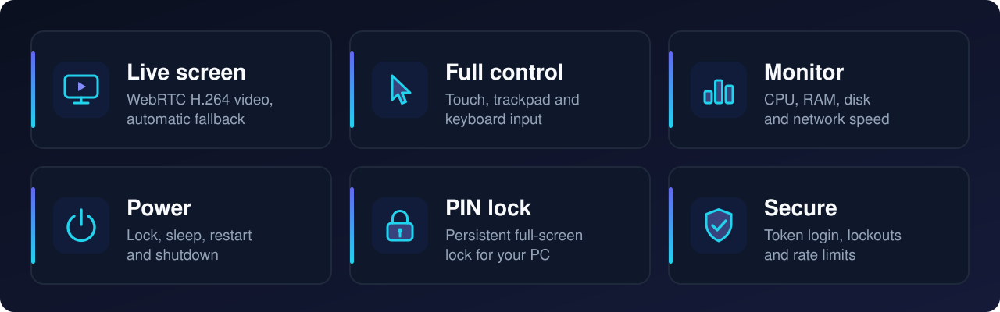

<div align="center">

# Remote PC Control

**See and control your own Windows PC from your phone.**<br>
Live screen · touch-as-mouse · keyboard · system monitor · power controls · PIN lock


[Install and run](#-install-and-run) ·
[Connect](#-connect-your-phone) ·
[Android app](#-android-app) ·
[Configuration](#-configuration) ·
[Other commands](#-other-commands) ·
[PIN lock](#-pin-lock) ·
[Troubleshooting](#-troubleshooting) ·
[Security](#-security)

</div>

---

<p align="center">
Control your Windows PC from your phone over <b>Tailscale</b>, <b>Wi-Fi</b> or a <b>Cloudflare</b> tunnel,<br>
using the Android app or a mobile browser.
</p>



## 🚀 Install and run

For a **Windows 10/11 x64** PC. Pick **one** option.

<table width="100%">
<tr>
<td width="50%" valign="top">
<h3>🅰️ Option A · From source</h3>
<i>Full features, updates with <code>git pull</code></i>
<ul>
<li><b>Needs:</b> Python 3.11+, Node.js 22, Git</li>
<li><b>Terminal:</b> yes, a few commands</li>
<li><b>Best for:</b> full features and the PIN lock screen</li>
<li><b>Update:</b> <code>git pull</code>, then run again</li>
</ul>
<a href="#option-a--from-source"><b>Go to Option A ↓</b></a>
</td>
<td width="50%" valign="top">
<h3>🅱️ Option B · Windows installer</h3>
<i>Quick install, no terminal</i>
<ul>
<li><b>Needs:</b> nothing to install first</li>
<li><b>Terminal:</b> no</li>
<li><b>Best for:</b> quick and easy setup</li>
<li><b>Update:</b> run the newer <code>Setup.exe</code></li>
</ul>
<a href="#option-b--windows-installer"><b>Go to Option B ↓</b></a>
</td>
</tr>
</table>

Run commands in **PowerShell**, as your normal user, in the signed-in desktop session you want to control.

### Option A · From source

**① First time** (installs everything, creates `.env` with a random token, starts the server)

```powershell
cd $HOME
git clone https://github.com/mainnetwallet/remote-pc-control.git
cd remote-pc-control
Set-ExecutionPolicy -Scope Process Bypass
.\scripts\setup.ps1
.\scripts\start.ps1
```

Keep the window open (port **8888**, `Ctrl+C` stops it). Setup prints the token once; see it again with:

```powershell
Select-String '^REMOTE_PC_TOKEN=' .env
```

**② New commit arrived** (update and run again; `start.ps1` stops the old server itself)

```powershell
cd $HOME\remote-pc-control
git pull
.\scripts\setup.ps1
.\scripts\start.ps1
```

**③ Server is off** (closed window, reboot, `Ctrl+C`)

```powershell
cd $HOME\remote-pc-control
.\scripts\start.ps1
```

> [!TIP]
> With autostart, run `Stop-ScheduledTask -TaskName RemotePCControl` before ② and `Start-ScheduledTask -TaskName RemotePCControl` instead of `start.ps1`. For ③ run only the second command.

Health check: `http://localhost:8888/api/health` returns `"ok":true`.

### 🧰 Other commands

Run from `$HOME\remote-pc-control`.

| I want to… | Command |
|---|---|
| Show the token | `Select-String '^REMOTE_PC_TOKEN=' .env` |
| Change the password | `.\scripts\set-password.ps1` (then restart the server) |
| Autostart at sign-in | `.\scripts\install-autostart.ps1` (remove: add `-Remove`) |
| Stop / start autostart task | `Stop-ScheduledTask -TaskName RemotePCControl` / `Start-ScheduledTask -TaskName RemotePCControl` |
| Control Task Manager, admin terminals | Administrator PowerShell, once: `.\scripts\install-autostart.ps1 -Admin` (gives the agent admin rights; use a strong password) |
| Set the PIN | `.\scripts\set-pin.ps1` |
| PIN lock screen at sign-in | `.\scripts\install-lock-overlay.ps1` (remove: add `-Remove`) |
| Quick Cloudflare tunnel | `.\scripts\start-tunnel.ps1` |
| Remove the Tailscale firewall rule | `.\scripts\remove-firewall.ps1` (Administrator) |
| Reinstall everything | `.\scripts\setup.ps1 -Force` |
| What FPS can my PC do? | `python tools\pc_capability.py` (add `--apply` to save to `.env`) |
| Run tests | `.\.venv\Scripts\python.exe -m pytest backend/tests tests -q` |
| Build the dashboard | `cd frontend; npm install; npm run build` |

Reset `.env` to the latest template (⚠ overwrites password, Gist and TURN settings): `Copy-Item .env .env.backup; Copy-Item .env.example .env -Force; .\scripts\set-password.ps1 NewPassword`

### Option B · Windows installer

1. [**Download RemotePCControl-Setup.exe**](https://github.com/mainnetwallet/remote-pc-control/releases/latest/download/RemotePCControl-Setup.exe) (latest release) and run it. It installs the app, autostart (admin) and the Tailscale-only firewall rule, then starts the agent.
2. The app window shows the **PC address and token** for the phone, and has server on/off, password, autostart, firewall, PIN and logs.
3. To update, run the newer Setup.exe.

**Built-in Tailscale:** app window → Internet → Built-in Tailscale → Turn on, then sign in with the phone's account (JPEG video only). No PIN lock screen in the installer; the agent runs as admin, so use a strong token. Files: `%LOCALAPPDATA%\RemotePCControl\`.

## 🌐 Connect your phone

| Method | How |
|---|---|
| **Tailscale** (private, fastest) | Same account on PC and phone, open `http://<tailscale ip -4>:8888` |
| **Same Wi-Fi** | Open `http://<PC-IPv4>:8888` (`ipconfig`); needs the LAN firewall rule below |
| **Cloudflare quick tunnel** | `.\scripts\start-tunnel.ps1` in a second window, open the printed `https://….trycloudflare.com` link |
| **Cloudflare permanent tunnel** | Free account and a domain, see below |

Enter the token, tap **Connect**, then **Start screen**. Modes: **Click** (tap = click, long-press = right click), **Drag** (hold left button), **Scroll**.

<details>
<summary><b>Wi-Fi (LAN) firewall rule</b></summary>

Administrator PowerShell:

```powershell
New-NetFirewallRule -DisplayName "RemotePCControl LAN" -Direction Inbound -Action Allow -Protocol TCP -LocalPort 8888 -RemoteAddress LocalSubnet -Profile Private
```

If Windows marks your Wi-Fi *Public*, switch it to *Private*. Remove the rule with `Remove-NetFirewallRule -DisplayName "RemotePCControl LAN"`. The Tailscale rule is created by `setup.ps1`; if it warned, run `setup.ps1` once from an Administrator PowerShell.

</details>

<details>
<summary><b>Cloudflare quick tunnel (no account, link changes every run)</b></summary>

Start the server first. The first tunnel run installs `cloudflared` with `winget` (open a new PowerShell if asked). Test with `https://<link>/api/health`.

To start the tunnel together with the server and publish the link to a secret Gist for the Android app:

1. Create a GitHub **classic** token with **only the `gist` scope**.
2. Add to `.env`:

   ```text
   QUICK_TUNNEL=1
   GIST_TOKEN=your-gist-token
   ```

3. Run `.\scripts\start.ps1`. The first run adds `GIST_ID=<id>` to `.env`.
4. In the Android app use `gist:<id>` as the *PC URL*.

</details>

<details>
<summary><b>Cloudflare permanent tunnel (same link forever)</b></summary>

Needs a free Cloudflare account and a domain on Cloudflare (Active). The tunnel runs as a Windows service; the server must also be running.

1. Dashboard → **Zero Trust → Networks → Tunnels → Create a tunnel → Cloudflared → Windows**.
2. In an **Administrator PowerShell** run the command the dashboard shows (it contains a secret token):

   ```powershell
   winget install --id Cloudflare.cloudflared
   cloudflared.exe service install <TOKEN-FROM-DASHBOARD>
   ```

3. Add a **public hostname**: subdomain `pc`, your domain, **Type HTTP**, **URL `localhost:8888`**.
4. Open `https://pc.yourdomain.com` on the phone.

**Protect it with Cloudflare Access:** Zero Trust → Access → Applications → Self-hosted → hostname → policy Allow, rule Emails = your email only. The Android app cannot pass that browser login (browser only).

**Problems:** `502` = server not running or URL is not `http://localhost:8888`; error 1033 = `Start-Service cloudflared`; stop access with `Stop-Service cloudflared`.

**বাংলা:** (১) domain Cloudflare-এ **Active** করুন (২) Zero Trust > Tunnels > Create a tunnel > Windows (৩) Dashboard-এর `cloudflared.exe service install <token>` Administrator PowerShell-এ চালান (৪) Public hostname: `pc`, Type **HTTP**, URL **`localhost:8888`** (৫) ফোনে `https://pc.আপনার-domain` খুলুন।

</details>

## 📱 Android app

1. [**Download the latest APK**](https://github.com/mainnetwallet/remote-pc-control/releases/latest/download/RemotePCControl-Android.apk) (tap it on the phone, or download on the PC and copy it over) and allow installation from this source. All builds: [Releases](https://github.com/mainnetwallet/remote-pc-control/releases).
2. Enter the *PC URL* (`http://100.x.x.x:8888`, LAN address, `https://….trycloudflare.com` or `gist:<id>`) and the token, then **Connect**. Both are stored encrypted; **Log out** forgets them.

It is a personal-use debug build, not a Play Store release. Screens: **Dashboard** (gauges, power buttons, PIN lock, quality) and **Session** (live screen, touch modes, trackpad, keys).

| Quality | Width | Max FPS | WebRTC bitrate limit |
|---|---|---|---|
| Low | 960 px | 20 | 1.5 Mbit/s |
| Medium (default) | 1280 px | 30 | 3 Mbit/s |
| High | 1920 px | 30 | 8 Mbit/s |
| Native | PC resolution | 30 | 20 Mbit/s |
| Ultra 60 / 120 | 1920 px | 60 / 120 | 12 / 16 Mbit/s |

Use **Native** on the same Wi-Fi or Tailscale for the sharpest picture. Ultra needs a PC, link and phone that all keep up.

Build it yourself: open `android/` in Android Studio (JDK 17, SDK 35) → **Build APK(s)**, or run `gradle assembleDebug` in `android/`.

## ⚙ Configuration

Settings are in `.env` (template: [`.env.example`](.env.example)). Restart the server after editing.

| Variable | Default | Meaning |
|---|---|---|
| `REMOTE_PC_TOKEN` | generated | Access password, min 4 characters (12+ recommended) |
| `REMOTE_PC_HOST` / `_PORT` | `0.0.0.0` / `8888` | Packaged `.exe` only; `start.ps1` always uses `0.0.0.0:8888` |
| `REMOTE_PC_WEBRTC` | `1` | WebRTC on/off (WebSocket is the fallback) |
| `REMOTE_PC_RTC_FPS` | `auto` | WebRTC max fps (`auto` = monitor refresh, up to 120) |
| `REMOTE_PC_RTC_BITRATE` | `4000` | Starting WebRTC bitrate limit, kbit/s |
| `REMOTE_PC_RTC_ENCODER` | `auto` | `auto`, `nvenc`, `qsv`, `amf` or `x264` |
| `REMOTE_PC_STUN_URL` | Google STUN | STUN server(s), comma separated |
| `REMOTE_PC_TURN_URL` / `_USER` / `_PASS` | empty | Optional TURN relay |
| `REMOTE_PC_FPS` / `_JPEG_QUALITY` / `_MAX_WIDTH` | `auto` / `55` / `1280` | Starting values of the JPEG stream |
| `REMOTE_PC_LATENCY_FIRST` | `1` | Shrink the picture on slow links (`0` = always chosen quality) |
| `REMOTE_PC_MOTION_QUALITY` / `_WIDTH` | `100` / `100` | Reduce frames while the picture moves (`100` = off) |
| `REMOTE_PC_CAPTURE` | `auto` | `mss` forces the classic capture |
| `REMOTE_PC_SHOW_CURSOR` | `1` | Draw a pointer on the stream |
| `REMOTE_PC_LOCK_BUTTON` | `pin` | `windows` keeps the Windows lock on the app's Lock button |
| `REMOTE_PC_LOCK_STATE` | `lock_state.json` | PIN-lock state file |
| `QUICK_TUNNEL` / `GIST_TOKEN` / `GIST_ID` | empty | Quick tunnel and Gist link (`start.ps1` only) |

**Latency:** Wi-Fi and Tailscale give direct UDP (~50 ms). A Cloudflare quick tunnel carries TCP only, so video falls back to the WebSocket stream. Behind CGNAT or a strict firewall you need TURN (e.g. [coturn](https://github.com/coturn/coturn) on a server with a public IP and UDP 3478); then set `REMOTE_PC_TURN_URL=turn:IP:3478`, `REMOTE_PC_TURN_USER` and `REMOTE_PC_TURN_PASS` in `.env`. Protocol details: [docs/ARCHITECTURE.md](docs/ARCHITECTURE.md#webrtc-and-stream-protocol).

## 🔐 PIN lock

A persistent full-screen lock for the PC itself (not Windows `Win+L`). It stays locked through sleep, restart and shutdown, and works even when the server is off.

1. Set a PIN (4-12 digits) in the app (PIN lock card) or with `.\scripts\set-pin.ps1`.
2. Install the lock screen once (source install):

   ```powershell
   .\scripts\install-lock-overlay.ps1
   ```

3. Lock from the app. Unlock from the app (the token is enough) or at the PC with the PIN. Five wrong PINs = 60-second cool-down.

With a PIN set, the app's **Lock** button uses this lock; without the lock screen installed it shows nothing. To keep the Windows lock there, set `REMOTE_PC_LOCK_BUTTON=windows`. Log: `%LOCALAPPDATA%\RemotePCControl\lock_overlay.log`.

**Limit:** it is an app window, not the sign-in screen, and **Ctrl+Alt+Delete cannot be blocked**. Use it as a privacy screen, not a replacement for your Windows password. Manual test on a real Windows 11 PC: lock, type the PIN (keyboard and keypad), try wrong PINs, try Alt+Tab/Win while locked, restart while locked, and lock/unlock from the app.

## 🩺 Troubleshooting

| Symptom | Fix |
|---|---|
| `python` or `npm` not found | Install Python 3.11+ and Node.js 22, open a new PowerShell |
| `git clone` says the folder exists | `cd $HOME\remote-pc-control`, then use ② |
| Token rejected | Use the full `REMOTE_PC_TOKEN` from `.env` |
| Cannot connect | Server running? Right URL and port? Tailscale on, same account? Firewall rule present? |
| Port 8888 in use | Run `start.ps1` again; it stops an older copy of this server but never another program |
| Autostart gone after a manual `start.ps1` | It stops the task on purpose: `Start-ScheduledTask -TaskName RemotePCControl` |
| Tunnel 502 | `start.ps1` is not running |
| Black screen | PC is locked or a UAC prompt is open |
| No input in Task Manager / admin windows | `.\scripts\install-autostart.ps1 -Admin` (Administrator PowerShell) |
| 429 "Too many failed attempts" | 8 wrong tokens lock a client for 5 min; 40 wrong tokens from anyone block logins for 10 min. Wait, then use the right token |
| 429 "Too many failed requests" | The same request failed 10 times in a minute (or 60 failed requests of any kind). Fix the cause, wait for `Retry-After` |
| App always shows "WebSocket" | No direct UDP path: use Tailscale or Wi-Fi, or set up TURN |
| `aiortc is not installed` | `.\scripts\setup.ps1 -Force`, restart the server |
| Lock button shows nothing | Run `.\scripts\install-lock-overlay.ps1` or set `REMOTE_PC_LOCK_BUTTON=windows` |

## 🔒 Security

> [!WARNING]
> Use this only on a PC you own. Anyone with the token and a reachable URL controls the PC.

**Keep access private**
- Reach the PC only through **Tailscale**, a trusted Wi-Fi, or a **Cloudflare** tunnel (add Cloudflare Access for a permanent link). Never port-forward or expose port `8888` to the internet.
- Use a long token (12+ characters), keep `.env` and the tunnel link private, and never commit `.env` or `lock_state.json`.
- Revoke any token you ever pasted into a chat or issue. `GIST_TOKEN` must be a classic token with **only the `gist` scope**.

**Built-in protection**
- **Wrong-token lockout:** 8 wrong tokens lock a client for 5 minutes; 40 wrong tokens from anyone block all logins for 10 minutes.
- **Repeated-failure limit:** the same request failing 10 times a minute, or 60 failed requests of any kind (scanners), gets HTTP 429 with `Retry-After`.
- **WebSocket login:** a wrong, garbled or silent first message counts as a failed login.
- **Control panel:** answers only on the PC itself, never from the phone, LAN or a tunnel, and also needs the token.
- **PIN lock:** persistent full-screen lock with a 60-second cool-down after 5 wrong PINs.

**Limits**
- The agent cannot control the Windows sign-in screen or UAC prompts and does not bypass Windows authentication.
- The installer's agent runs as administrator; the PIN lock cannot block Ctrl+Alt+Delete.

**Report a vulnerability** privately via the GitHub Security tab (not a public issue), with what you did, what happened and the commit hash.

## 🛠 Project layout

```text
backend/     FastAPI server        frontend/   React web dashboard
android/     Android app           scripts/    setup, start, tunnel, autostart, firewall
installer/   Inno Setup installer  tools/      Wake-on-LAN, pc_capability.py
docs/        ARCHITECTURE.md       lock_overlay.py   full-screen PIN lock
```

Code map, API, protocol, tests and CI: [docs/ARCHITECTURE.md](docs/ARCHITECTURE.md).
