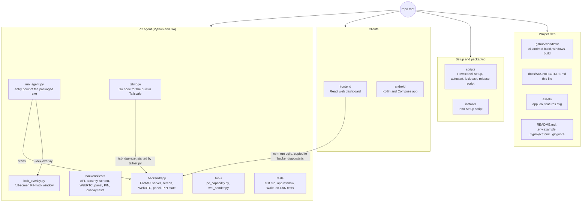
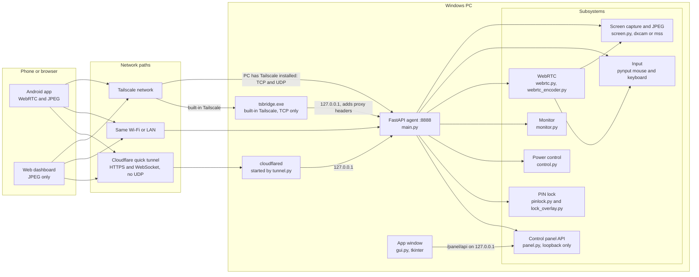
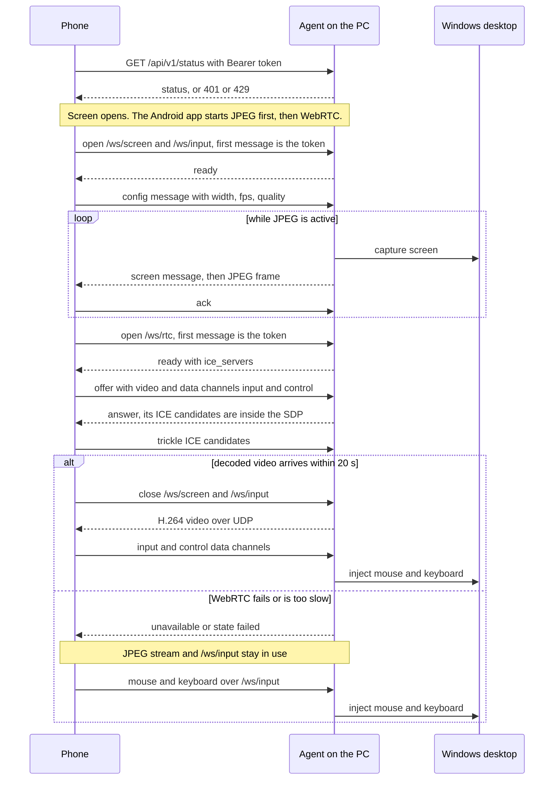
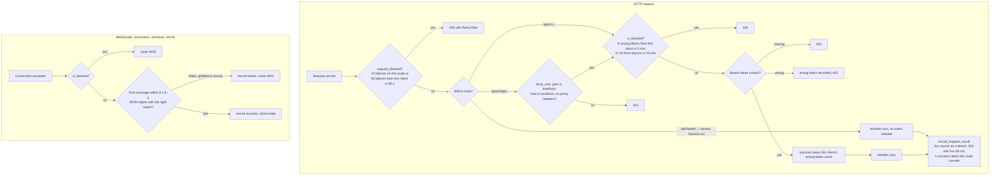
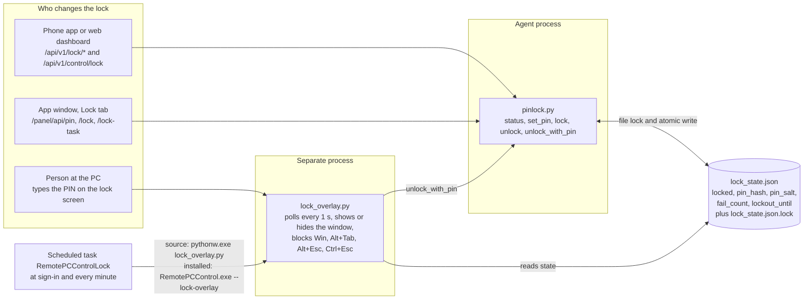
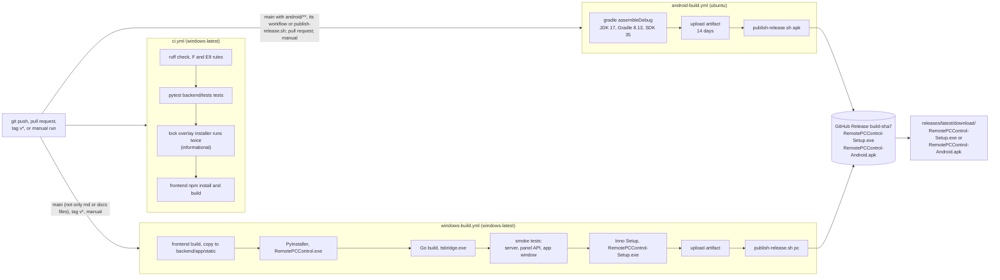
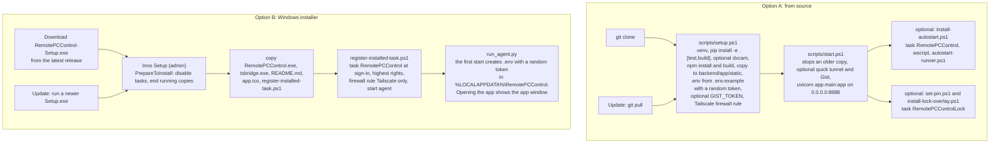

# Architecture

How Remote PC Control is built: code, runtime paths, APIs, security, tests and release pipeline. Every statement here was checked against the code. If this file and the code disagree, the code is right.

[← Project README](../README.md)

## Contents

1. [Overview](#overview)
2. [Diagrams](#diagrams)
   - [Repository map](#repository-map)
   - [System architecture](#system-architecture)
   - [Runtime sequence](#runtime-sequence)
   - [Security flow](#security-flow)
   - [PIN lock](#pin-lock)
   - [Build and release pipeline](#build-and-release-pipeline)
   - [Install and update flow](#install-and-update-flow)
3. [Module map](#module-map)
4. [HTTP and WebSocket API](#http-and-websocket-api)
5. [Security model](#security-model)
6. [WebRTC and stream protocol](#webrtc-and-stream-protocol)
7. [Configuration](#configuration)
8. [Scripts](#scripts)
9. [Frontend and Android](#frontend-and-android)
10. [Tests and CI](#tests-and-ci)
11. [Known limitations](#known-limitations)

## Overview

Remote PC Control shows and controls a Windows PC from an Android app or a mobile browser. A Python agent (FastAPI, port **8888**) runs in the signed-in desktop session of the PC. It streams the screen, applies mouse and keyboard input, reports system status, and runs power and PIN-lock actions. The screen goes out as WebRTC H.264 video, or as JPEG frames over a WebSocket when WebRTC is not possible. The phone reaches the PC over Tailscale, the same Wi-Fi, or a Cloudflare quick tunnel. On the PC, a desktop window and a local-only API manage the agent. It installs from source with PowerShell scripts, or with a Windows installer.

> [!NOTE]
> The agent must run as the Windows user who is signed in to the desktop you want to control. It cannot control the Windows sign-in screen or UAC prompts.

## Diagrams

### Repository map



### System architecture



### Runtime sequence



### Security flow



### PIN lock



### Build and release pipeline



### Install and update flow



## Module map

### Backend package: `backend/app/`

| File | Role | Key functions, classes or routes |
|---|---|---|
| `main.py` | FastAPI app. Routes, HTTP failure-limit middleware, startup and shutdown, static dashboard. | `lifespan` validates settings, warns when not elevated, starts `webrtc.warm_up` and `tailnet.autostart` in threads, and closes WebRTC sessions and the built-in Tailscale on exit. `repeated_failure_limit` is the middleware. |
| `config.py` | Reads `.env` into `settings`. Frame-rate helpers. | `Settings`, `fps_setting`, `monitor_hz`, `validate_settings`. `FPS_CEILING=120`, `WS_FPS_CEILING=60`, `MIN_TOKEN_LEN=4`. |
| `paths.py` | Where data lives. | `frozen()` (inside the PyInstaller exe), `data_dir()` (current folder from source; `%LOCALAPPDATA%\RemotePCControl` for the exe, or the exe folder if it already holds a `.env`). |
| `security.py` | Token check, wrong-token lockout, repeated-failure limiter. | `require_auth`, `verify_token`, `token_ok`, `client_key`, `is_blocked`, `record_fail`, `record_success`, `request_blocked`, `record_request_result`, `reset_all`. |
| `monitor.py` | System status. | `snapshot()` (CPU, memory, disk, network rate, uptime, hostname, elevated flag), `is_elevated()`. |
| `control.py` | Windows power actions. HTTP 501 on other systems. | `lock_workstation`, `sleep_pc`, `power_action` (runs `shutdown.exe /r` or `/s` with `/t 5`; needs `confirm`). |
| `pinlock.py` | PIN-lock state in `lock_state.json`. | `status`, `set_pin`, `lock`, `unlock`, `unlock_with_pin`, `pin_lockout_remaining`, `resolve_state_path`, `StateFileError`. |
| `screen.py` | `/ws/screen` and `/ws/input`. Capture (DXGI through `dxcam`, else `mss`), JPEG encoding, flow control, input handling. | `screen_socket`, `input_socket`, `stream_frames`, `encode_frame`, `StreamConfig`, `handle_input`, `coalesce_input`, `_authenticate` (also used by `/ws/rtc`). |
| `webrtc.py` | `/ws/rtc` signaling, one `RtcSession` per phone, screen video track, data-channel input. | `rtc_socket`, `parse_signal`, `ice_servers`, `RtcConfig`, `RtcSession`, `InputSink`, `warm_up`, `shutdown_all`. |
| `webrtc_encoder.py` | Low-latency H.264 encoder that replaces aiortc's own. | `install`, `probe_backends`, `backend_order`, `Limits`, `LowLatencyH264Encoder`. |
| `panel.py` | Local-only control-panel API under `/panel/api`. | `local_only`, route functions listed in [Control panel API](#control-panel-api-panelapi). |
| `envfile.py` | Edits `.env` without touching other lines. Validates what the window may change. | `FIELDS`, `update`, `validate_setting`, `validate_token`. |
| `winadmin.py` | PowerShell wrappers for the app window: scheduled tasks, firewall rules, restart, quit. | `system_status`, `set_autostart`, `set_lock_task`, `set_firewall`, `restart_agent`, `quit_agent`. Task names `RemotePCControl` and `RemotePCControlLock`; rules `RemotePCControl Tailscale only` and `RemotePCControl LAN`. |
| `tailnet.py` | Runs `tsbridge.exe` (built-in Tailscale) and reads its status file. | `set_enabled`, `status`, `start`, `stop`, `autostart`, `find_bridge`. State folder `data_dir()/tailscale`. |
| `tunnel.py` | Runs a Cloudflare quick tunnel (`cloudflared`). Can install it with `winget`. | `find_cloudflared`, `install`, `start`, `stop`, `status`. |
| `firstrun.py` | Start-up helpers of the packaged exe. Do nothing when run from source. | `prepare` (data folder, `.env` with a random token, log redirect to `agent.log`), `server_state`, `classify`, `stop_old_server`, `message`. |
| `gui.py` | Desktop window (tkinter) with six tabs: Connect, Startup, Lock, Internet, Settings, Agent. Talks to `/panel/api`. | `PanelClient`, `App`, `start_server`, `run`. |
| `gui_text.py` | English and Bengali texts of the window. | `TEXT`. |
| `__init__.py` | Empty package marker. | |

### Other code

| File | Role |
|---|---|
| `run_agent.py` | Entry point of `RemotePCControl.exe`. Flags: `--background` (no window), `--lock-overlay` (run the PIN lock screen), `--gui-selftest <file>` (build check). Replaces an older server on the port, opens the window, or runs Uvicorn. Crashes go to `%LOCALAPPDATA%\RemotePCControl\crash.log`. |
| `lock_overlay.py` | Full-screen PIN lock. Own process, single instance per session (mutex), keyboard hook, polls `lock_state.json` every second. Log: `%LOCALAPPDATA%\RemotePCControl\lock_overlay.log`. |
| `tsbridge/main.go` | Go program using `tailscale.com/tsnet`. Joins the tailnet in user space (no driver, no admin rights) and forwards `<tailnet-ip>:<port>` to `127.0.0.1:<port>`. Always sets `X-Forwarded-For` and `Cf-Connecting-Ip`. Exits when its stdin closes. Writes its status to a JSON file. |
| `tools/pc_capability.py` | Measures refresh rate, capture speed, JPEG speed and H.264 encoders. `--apply` writes recommended FPS values to `.env`. |
| `tools/wol_sender.py` | Sends a Wake-on-LAN magic packet from a device on the target LAN. The agent does not use it. |

## HTTP and WebSocket API

"Token" means `Authorization: Bearer <REMOTE_PC_TOKEN>`. WebSockets send `{"token":"..."}` as the first text message instead.

### Agent API

| Method | Path | Auth | Purpose |
|---|---|---|---|
| GET | `/api/health` | none | Liveness. Returns `{"ok":true,"service":"remote-pc-control","panel":true}`. The exe uses it to tell its own server from another program. |
| GET | `/api/v1/status` | token | CPU, memory, disk, network rate, uptime, hostname, `elevated`. |
| GET | `/api/v1/metrics` | token | Same data as `status`. |
| POST | `/api/v1/control/lock` | token | With a PIN set: engages the PIN lock (`"mode":"pin"`). Otherwise, or with `REMOTE_PC_LOCK_BUTTON=windows`: Windows lock (`"mode":"windows"`). |
| POST | `/api/v1/control/sleep` | token | Requests sleep. No confirmation field. |
| POST | `/api/v1/control/restart` | token | Restart in 5 s. Body must be `{"confirm":true}`, otherwise 400. |
| POST | `/api/v1/control/shutdown` | token | Shutdown in 5 s. Same body rule. Any other action name gives 404. |
| GET | `/api/v1/lock/status` | token | `{"locked":bool,"pin_set":bool}`. |
| POST | `/api/v1/lock/pin` | token | Sets the unlock PIN: `{"pin":"1234"}`, 4-12 digits, otherwise 400. |
| POST | `/api/v1/lock/lock` | token | Engages the PIN lock. 400 when no PIN is set. |
| POST | `/api/v1/lock/unlock` | token | Releases the PIN lock. No PIN needed: the token is the proof. |
| GET | `/api/v1/wol/status` | token | Always `supported:false, configured:false`. |
| POST | `/api/v1/wol/wake` | token | Always 501. |
| GET | `/favicon.ico` | none | 204. |
| GET | `/`, `/assets/*` | none | The web dashboard from `backend/app/static/`. Without that folder `/` answers 503 `"Build frontend first"`. |

When the lock state file cannot be read or written, the lock routes answer **503** instead of guessing.

### WebSockets

| Path | Purpose | Details |
|---|---|---|
| `/ws/screen` | JPEG screen stream (fallback) | [JPEG stream](#jpeg-stream-wsscreen) |
| `/ws/input` | Mouse and keyboard JSON, pointer position back | [Input messages](#input-messages) |
| `/ws/rtc` | WebRTC signaling | [Signaling](#signaling-wsrtc) |

Close codes used by all three: `4429` client is locked out, `4401` wrong, missing or late token, `1008` too many invalid messages (`/ws/rtc`) or invalid input (`/ws/input`), `1011` internal error, `1000` normal close. Outside Windows `/ws/screen` sends `{"type":"error","message":"Windows required"}` and `/ws/rtc` answers `unavailable`.

### Control panel API (`/panel/api`)

For the app window on the PC only. Needs a loopback peer, a `localhost`, `127.0.0.1` or `[::1]` Host header, **no** proxy headers (`cf-connecting-ip`, `cf-ray`, `x-forwarded-for`, `x-forwarded-host`, `forwarded`, `x-real-ip`) and the token.

| Method | Path | Purpose |
|---|---|---|
| GET | `/panel/api/state` | Host name, port, elevated, installed, addresses (LAN and `100.x`), built-in Tailscale, editable settings, lock state, tunnel, `.env` path. |
| GET | `/panel/api/system` | State of the two scheduled tasks and the two firewall rules. |
| GET, POST | `/panel/api/token` | Show the token. Set a new one (4-200 characters, no spaces, quotes, backslash, `$` or `#`). Takes effect at once. |
| POST | `/panel/api/token/random` | New random token (`secrets.token_urlsafe(32)`). |
| POST | `/panel/api/settings` | Validate and save the video settings listed in `envfile.FIELDS`. Needs an agent restart. |
| POST | `/panel/api/autostart`, `/lock-task` | Create or remove the sign-in tasks (installed exe only). |
| POST | `/panel/api/firewall` | Create or remove rule `tailscale` or `lan`. |
| POST | `/panel/api/pin`, `/lock` | Set the PIN. Lock or unlock (`{"locked":bool}`). |
| GET, POST | `/panel/api/tailscale`, `/tailscale/{enable\|disable}` | Built-in Tailscale status and switch. |
| GET, POST | `/panel/api/tunnel`, `/tunnel/{install\|start\|stop}` | Cloudflare quick tunnel. |
| GET, POST | `/panel/api/logs/{agent\|lock}`, `/logs/{name}/clear` | Last 200 lines of `agent.log` or `lock_overlay.log`. Empty a log in place. |
| POST | `/panel/api/restart`, `/quit` | Restart or stop the agent. |

## Security model

All limits below are in `backend/app/security.py` unless another file is named.

| Protection | Limit |
|---|---|
| Token comparison | Constant time (`hmac.compare_digest`). |
| Token length | At least 4 characters (`MIN_TOKEN_LEN`). Below 12 the server prints a warning. `setup.ps1` and the exe create long random tokens. |
| Wrong-token lockout, per client | `MAX_FAILS = 8` wrong tokens within `WINDOW_SECONDS = 300`. The client is refused, even with the right token, until the window passes. A correct token clears that client's count. |
| Wrong-token lockout, global | `GLOBAL_MAX_FAILS = 40` within `GLOBAL_WINDOW_SECONDS = 600`, counted over all clients. Everyone is refused until the window passes. A success does not clear it. |
| Repeated-failure limiter, per route | `ROUTE_MAX_FAILS = 10` failed (4xx) answers for the same client, method and path within `ROUTE_WINDOW_SECONDS = 60` gives 429 with `Retry-After`. |
| Repeated-failure limiter, per client | `CLIENT_MAX_FAILS = 60` failed answers on any paths within `CLIENT_WINDOW_SECONDS = 60` blocks the client for the rest of the window. |
| What counts | 4xx answers. 429 and 5xx do not. A success clears that route's counter. Tables hold at most `MAX_TRACKED = 5000` entries (expired entries go first, then the oldest half). All counters are in memory and reset when the agent restarts. |
| Client identity | The peer address. `cf-connecting-ip` is trusted only when the peer is loopback (`127.0.0.1`, `::1`, `localhost`), which is the case for `cloudflared` and `tsbridge`. It is cut to 64 characters. A direct client cannot invent addresses. |
| WebSocket login | The first message must arrive within 8 s and be a JSON object with the token. Silent, garbled, non-object or wrong first messages count as failed logins (`4401`). A locked-out client is closed with `4429` before it is read. |
| Control panel | `local_only` (see [Control panel API](#control-panel-api-panelapi)) and the token. `tsbridge` adds proxy headers to everything it forwards, so tailnet traffic can never reach the panel. |
| PIN | 4-12 digits. PBKDF2-HMAC-SHA256, 200 000 rounds, random 16-byte salt. 5 wrong PINs at the PC (`MAX_PIN_FAILS`) start a 60 s cool-down (`PIN_LOCKOUT_SECONDS`), kept in the state file. An unreadable state file never counts as unlocked. No PIN, hash or salt is logged (`pinlock.py`). |
| Input limits | Scroll at most 20 steps per message. `rel` moves at most 500 px per axis. `type` text is cut to 500 characters. A hotkey has at most 4 keys. Bad messages are ignored (`screen.py`). |
| WebRTC limits | 4 sessions (`MAX_SESSIONS`), 64 KiB SDP, 2048-byte candidate, 4096-byte data-channel message, 5 invalid signaling messages, 20 s to connect (`webrtc.py`). Only data channels `input` and `control` are accepted. |
| Secrets in the repo | `.env`, `lock_state.json` and logs are in `.gitignore`. |
| Android | The saved password is encrypted with an AES-GCM key in the Android Keystore (`SecureStore.kt`). Log out clears it. |
| Web dashboard | Keeps the token in browser `localStorage` (`rpc-token`) until Log out. |

Network rules: reach the agent only through Tailscale, a trusted Wi-Fi or a Cloudflare tunnel. Never port-forward TCP 8888. The firewall rules that the scripts and the app window create allow TCP 8888 from `100.64.0.0/10` (Tailscale) or from the local subnet on private networks (LAN rule, app window only).

## WebRTC and stream protocol

### Transports

| Transport | Used for | Notes |
|---|---|---|
| `/ws/rtc` WebSocket | WebRTC signaling | Only exchanges the offer, answer, candidates and state. |
| WebRTC video | Screen, H.264 over UDP | Old frames are dropped, not queued. |
| WebRTC data channels `input`, `control` | Input and live settings | Same JSON as `/ws/input`. |
| `/ws/screen` WebSocket | Screen, JPEG frames | Fallback. Flow control and adaptive size. |
| `/ws/input` WebSocket | Input and pointer position | Used until WebRTC takes over, and after a fallback. |

The Android app uses all of them. The web dashboard uses only `/ws/screen` and `/ws/input`.

### JPEG stream (`/ws/screen`)

After the token the server sends `{"type":"ready"}`, then `{"type":"screen","width","height","max_width","fps","quality"}` and binary JPEG frames. The `.env` values (`REMOTE_PC_MAX_WIDTH`, `REMOTE_PC_FPS`, `REMOTE_PC_JPEG_QUALITY`) are only the start values of each connection. The client changes them live:

```json
{"type":"config","max_width":1920,"fps":15,"quality":70,"cursor":true}
```

All fields are optional. `max_width` is `0` (native) or 320-3840. `fps` is 1-60. `quality` is 25-90 (the `.env` value is limited to 25-85). Out-of-range numbers are clamped, unusable values are ignored, and the settings are per connection. The server answers with a new `screen` message and a fresh frame. Frames are never upscaled.

- **Sharp mode.** From quality 85 up the server uses Lanczos scaling and full-resolution colour (4:4:4).
- **Cursor.** With `"cursor":true` the client draws the pointer, frames carry none, and a pointer-only move does not re-encode the screen. Without it the server draws a small arrow into the frame when `REMOTE_PC_SHOW_CURSOR` is on.
- **Acks and flow control.** The client sends `{"type":"ack"}` after showing each frame. After the first ack the server keeps 2 to 6 frames in flight (the window grows with the measured round-trip time), measures the upload speed from the ack spacing, and sends a new frame only if it fits the link without queueing behind old ones. No ack for 1 s resets the count. A client that never acks gets the old fixed-rate stream.
- **Latency first.** With acks and `REMOTE_PC_LATENCY_FIRST=1`, a slow link makes frames smaller at once: quality drops first (to about 55 % of the set value), then the width (to at least 40 %). It grows back one step (10 quality, 80 px) after 2 s of a fast link.
- **Motion quality.** While the picture keeps changing (0.3 s window), frames use `REMOTE_PC_MOTION_QUALITY` percent of the quality and `REMOTE_PC_MOTION_WIDTH` percent of the width (`100` = off). One sharp frame follows after 0.2 s of rest.
- **Keep-alive.** An unchanged screen is re-sent every 3 s.
- **Capture.** `REMOTE_PC_CAPTURE=auto` tries DXGI through the optional `dxcam` package and switches to `mss` for good after any problem. Only the primary monitor is captured. Capture and encoding run on two worker threads and overlap when the PC is the bottleneck.

### Input messages

The same JSON is accepted on `/ws/input` and on both WebRTC data channels. Positions are normalised (`nx`, `ny` from 0 to 1 of the visible picture). Pixel `x`, `y` still work for old clients.

| `type` | Fields | Effect |
|---|---|---|
| `move` | `nx`, `ny` | Pointer to a position. |
| `rel` | `dx`, `dy` | Move by pixels, clamped to the monitor and to ±500. |
| `click` | `button` (`left`, `right`, `middle`), `count` (1 or 2), optional `nx`, `ny` | Click. Without a position it acts at the current pointer. |
| `down`, `up` | `button`, optional `nx`, `ny` | Press or release, for dragging. |
| `scroll` | `dx`, `dy` | Wheel steps, clamped to ±20. `dy > 0` scrolls up. |
| `key` | `key` | One key: a printable character, or `ENTER`, `TAB`, `BACKSPACE`, `ESC`, `SPACE`, arrows, `CTRL`, `ALT`, `SHIFT`, `DELETE`, `HOME`, `END`, `PAGEUP`, `PAGEDOWN`, `WIN`, `F1` to `F12`. |
| `hotkey` | `keys` (up to 4) | Press in order, release in reverse. An unknown key cancels the whole hotkey. |
| `type` | `text` | Types up to 500 characters. |
| `watch_cursor` | `on` | The PC then sends `{"type":"cursor","nx","ny","w","h"}` up to 60 times a second while the pointer moves, plus a heartbeat every 0.25 s. |

On `/ws/input` and the data channels, consecutive `rel` messages are summed and consecutive `move` messages keep only the last one, so a slow moment never causes a delayed pointer. Clicks and keys are never dropped or reordered.

### WebRTC video

- The video track captures the newest screen only when the encoder asks for the next frame, so old frames are never queued. An unchanged screen is re-sent every 0.5 s.
- The answer prefers H.264 and keeps VP8 as a software fallback.
- Encoder order: `h264_nvenc`, `h264_qsv`, `h264_amf`, then `libx264` (`ultrafast`, `zerolatency`, no B-frames). `REMOTE_PC_RTC_ENCODER` forces one (libx264 stays the last resort). A hardware encoder that fails to open or to encode is skipped for the rest of the process. `webrtc.warm_up` tests them once at server start, so the first connection after a reboot is not slow.
- Key frames come at least every 120 frames. Receivers also ask for one after packet loss.
- The bitrate follows the receiver's estimate. The cap is `REMOTE_PC_RTC_BITRATE` (300-30000 kbit/s) or the client's `bitrate` (200-30000 kbit/s). The floor is 1 Mbit/s, or one sixth of the cap when that is higher, and never above the cap. With several sessions the highest cap wins. The encoder re-opens only when the target moves by more than 25 % and not more than every 2 s.
- The frame rate is capped by `REMOTE_PC_RTC_FPS` (`auto` = monitor refresh, up to 120). Frame size is the native size scaled to `max_width`, with even sides.

### Signaling (`/ws/rtc`)

After the token message:

1. Server: `{"type":"ready","ice_servers":[...]}`, or `{"type":"unavailable","reason":"..."}` and a normal close. Reasons: WebRTC off, not Windows, `aiortc` missing, too many sessions. The client then uses `/ws/screen`.
2. Client: `{"type":"offer","sdp":"..."}` with a video section (receive only) and data channels `input` (unordered, no retransmits) and `control` (reliable, ordered). Server: `{"type":"answer","sdp":"..."}`.
3. Client: `{"type":"candidate","candidate":{"candidate":"candidate:...","sdpMid":"0","sdpMLineIndex":0}}`, and `"candidate":null` at the end. The server sends no candidate messages: its candidates are inside the answer.
4. Server: `{"type":"state","state":"..."}` on every connection-state change. `{"type":"error","message":"..."}` for a bad message.
5. Client: `{"type":"bye"}` ends the session.

Data channel `control` also carries `{"type":"config","max_width","fps","bitrate","cursor"}` (all optional, applied live) and `{"type":"ping","t":...}`. The server answers config with `{"type":"screen","width","height","max_width","fps","bitrate","transport":"webrtc"}` and ping with `{"type":"pong","t":...}`.

A working session survives the signaling socket closing. It ends when the peer connection fails or closes, or when the `control` channel closes. A session that is not connected 20 s after the answer is closed.

### Fallback rules (Android app)

1. Tapping *Start screen* starts the JPEG stream and `/ws/input` at once, then opens `/ws/rtc`.
2. When WebRTC frames are really decoded, the app shows the video and closes the two WebSockets. Input then goes over the data channels.
3. If WebRTC fails, says `unavailable`, or has decoded nothing after 20 s, the JPEG stream simply stays and the app shows a notice.
4. If a live WebRTC session breaks, the app falls back to `/ws/screen`. A drop of under 5 s does not end a working session.

### What each network gives

| Network | Result |
|---|---|
| Same Wi-Fi or LAN | Direct UDP, lowest latency. |
| Tailscale installed on PC and phone | Direct UDP over the Tailscale addresses. |
| Internet, both sides reachable through STUN | Direct UDP after NAT punch-through. |
| Mobile data behind CGNAT or a strict firewall | Needs a TURN relay (`REMOTE_PC_TURN_*`). Otherwise JPEG. |
| Cloudflare quick tunnel | TCP only. Signaling works, video does not. JPEG. |
| Built-in Tailscale (`tsbridge`) | TCP only. JPEG. |

## Configuration

The full table with defaults and ranges is in the [README](../README.md#-configuration). The annotated template is [`.env.example`](../.env.example). Restart the agent after editing `.env`. Clients can still change stream quality while connected.

| Group | Variables | Purpose |
|---|---|---|
| Access | `REMOTE_PC_TOKEN`, `REMOTE_PC_HOST`, `REMOTE_PC_PORT` | Password and listen address. Host and port are used only by `run_agent.py` (the exe). `start.ps1` always binds `0.0.0.0:8888`. The code default for host is `127.0.0.1`; `.env.example` sets `0.0.0.0`. |
| JPEG stream | `REMOTE_PC_FPS`, `REMOTE_PC_JPEG_QUALITY`, `REMOTE_PC_MAX_WIDTH` | Start values of each `/ws/screen` connection. |
| Adaptive JPEG | `REMOTE_PC_LATENCY_FIRST`, `REMOTE_PC_MOTION_QUALITY`, `REMOTE_PC_MOTION_WIDTH` | Smaller frames on slow links and during motion. |
| Capture | `REMOTE_PC_CAPTURE`, `REMOTE_PC_SHOW_CURSOR` | `auto` or `mss`. Pointer drawn into frames. |
| WebRTC | `REMOTE_PC_WEBRTC`, `REMOTE_PC_RTC_FPS`, `REMOTE_PC_RTC_BITRATE`, `REMOTE_PC_RTC_ENCODER` | On or off, frame-rate cap, bitrate cap, encoder choice. |
| NAT traversal | `REMOTE_PC_STUN_URL`, `REMOTE_PC_TURN_URL`, `REMOTE_PC_TURN_USER`, `REMOTE_PC_TURN_PASS` | ICE servers sent to clients in `ready`. |
| PIN lock | `REMOTE_PC_LOCK_BUTTON`, `REMOTE_PC_LOCK_STATE` | Which lock the Lock button uses. Where the state file is (a relative path is relative to the project or exe folder). |
| Tunnel (`start.ps1` only) | `QUICK_TUNNEL`, `GIST_TOKEN`, `GIST_ID` | Start a quick tunnel and publish its link to a secret Gist. |

The app window can change only: `REMOTE_PC_RTC_FPS`, `REMOTE_PC_FPS`, `REMOTE_PC_RTC_BITRATE`, `REMOTE_PC_JPEG_QUALITY` (25-85), `REMOTE_PC_MAX_WIDTH` (0-7680), `REMOTE_PC_RTC_ENCODER`, `REMOTE_PC_CAPTURE`, `REMOTE_PC_WEBRTC`, `REMOTE_PC_SHOW_CURSOR` (list in `envfile.FIELDS`), plus the token.

### Files the program creates

| File | Where | What |
|---|---|---|
| `.env` | Source: project folder. Exe: `%LOCALAPPDATA%\RemotePCControl\` (or the exe folder if an older install already has one there) | Settings and token. |
| `lock_state.json` (+ `.lock`) | Project folder or exe folder, or `REMOTE_PC_LOCK_STATE` | PIN-lock state. |
| `agent.log` | Exe data folder | Output of the exe, written only when it has no console. Deleted at start when over 1 MB. |
| `lock_overlay.log` | `%LOCALAPPDATA%\RemotePCControl\` | Lock screen log. |
| `crash.log` | `%LOCALAPPDATA%\RemotePCControl\` | Start-up crash of the exe. |
| `tailscale\` (`enabled`, `state\`, `status.json`, `tailscale.log`) | Data folder | Built-in Tailscale. |
| `setup.log` | `%ProgramData%\RemotePCControl\` | Result of `register-installed-task.ps1`. |
| `autostart.log`, `server.out.log`, `server.err.log`, `cloudflared.log`, `cloudflared.out.log` | Project folder | Source-install autostart and tunnel logs. |

## Scripts

All PowerShell unless noted. Run them from the project folder, as the normal user (administrator only where stated).

| File | What it does |
|---|---|
| `scripts/setup.ps1` | Creates `.venv`, installs the package (`pip install -e ".[test,build]"`) and optional `dxcam`, runs `npm install` and `npm run build`, copies `frontend/dist` to `backend/app/static`. Creates `.env` from `.env.example` with a random token, or adds settings that are new in `.env.example`. Asks once for an optional `GIST_TOKEN`. Tries to add the `RemotePCControl Tailscale only` firewall rule. `-Force` redoes everything. Skips work that is already up to date (hash stamps). |
| `scripts/start.ps1` | Stops the old scheduled task and an older copy of this server on port 8888 (refuses to touch other programs). With `QUICK_TUNNEL=1` installs and starts `cloudflared` and can publish the link to a secret Gist (`pc-url.txt`). Runs `uvicorn app.main:app --app-dir backend --host 0.0.0.0 --port 8888`. |
| `scripts/start-tunnel.ps1` | Installs `cloudflared` if needed and runs a quick tunnel to `localhost:8888`. |
| `scripts/set-password.ps1` | Writes `REMOTE_PC_TOKEN` to `.env` (4 or more characters, no spaces). |
| `scripts/set-pin.ps1` | Asks for a PIN (hidden) and stores it through `pinlock.set_pin`, passing it on stdin. |
| `scripts/install-autostart.ps1` | Creates or removes (`-Remove`) task `RemotePCControl`: sign-in trigger with 10 s delay, runs `autostart-hidden.vbs`. `-Admin` uses the highest run level. |
| `scripts/autostart-hidden.vbs` | Starts `autostart-runner.ps1` without a window. |
| `scripts/autostart-runner.ps1` | Waits for the network (internet reachable, and a `100.x` address if Tailscale is installed), runs `start.ps1`, restarts it 10 s after it stops. Exits if port 8888 is already in use. |
| `scripts/install-lock-overlay.ps1` | Creates or removes (`-Remove`) the single task `RemotePCControlLock` running `pythonw.exe lock_overlay.py`: sign-in trigger plus a one-minute watchdog. Removes duplicate tasks. Safe to run twice. |
| `scripts/register-installed-task.ps1` | Run by the installer, elevated. Registers the agent task (`--background`) or, with `-Kind lock`, the lock task (`--lock-overlay`) at sign-in with the highest run level. Adds the Tailscale firewall rule. `-Remove`, `-NoStart`, `-NoFirewall` are used by the uninstaller and the app window. Logs to `setup.log`. |
| `scripts/remove-firewall.ps1` | Removes the `RemotePCControl Tailscale only` rule (administrator). |
| `scripts/publish-release.sh` (bash) | Used by the two build workflows. Creates or updates release `build-<sha7>`, uploads the file just built, and copies the other download from the newest earlier release that has it. |
| `scripts/configure-installed.ps1` | Old helper that writes a first `.env` for a packaged exe. Not used by the installer, the workflows or any other file: the exe does this itself (`firstrun.prepare`). |
| `installer/RemotePCControl.iss` | Inno Setup script. Needs administrator rights. Installs `RemotePCControl.exe`, `tsbridge.exe`, `README.md`, `app.ico` and `register-installed-task.ps1` to `Program Files\RemotePCControl`. Before copying it disables and ends both tasks and the running programs. The uninstaller removes both tasks and ends the programs. |
| `tools/pc_capability.py` | See [Other code](#other-code). |
| `tools/wol_sender.py` | See [Other code](#other-code). |

## Frontend and Android

### Web dashboard (`frontend/`)

React 18, TypeScript and Vite. `npm run build` runs `tsc -b` and `vite build`. The result is copied to `backend/app/static/`, which the agent serves at `/`.

| File | Role |
|---|---|
| `src/main.tsx` | Mounts `App`. |
| `src/App.tsx` | Login (token kept in `localStorage`), status and metrics every 2.5 s, power buttons with a confirm dialog, PIN-lock card, quality presets, and the `/ws/screen` and `/ws/input` sockets. Sends `ack` per frame. |
| `src/RemoteScreen.tsx` | Touch and mouse control on the picture: click, drag and scroll modes, long-press right click, two-finger scroll, quick keys, text box, fullscreen. |
| `src/style.css` | Dark responsive styles. |
| `index.html`, `package.json`, `tsconfig.json`, `vite.config.ts` | Build setup. |

### Android app (`android/`)

Kotlin 2.1, Jetpack Compose, OkHttp, and `stream-webrtc-android`. Min SDK 26, target and compile SDK 35, JDK 17, Gradle 8.13 in CI. `versionName` is `1.3.<CI run number>` and `versionCode` is `100 + run number`. Every build is signed with the committed `app/debug.keystore`, so updates install over each other.

| File | Role |
|---|---|
| `MainActivity.kt` | Edge-to-edge window. Picks the page: loading, connect, dashboard or session. Keeps the screen on during a session. |
| `RemoteController.kt` | All state and networking. REST calls, `gist:<id>` link lookup (file `pc-url.txt`), auto sign-in, quality presets (Low, Medium, High, Native, Ultra 60, Ultra 120), the JPEG-first then WebRTC logic, fallback and cursor prediction. |
| `Rtc.kt` | `RtcClient`: `/ws/rtc` signaling, peer connection, data channels `input` and `control`, ping and stats. |
| `ConnectScreen.kt` | URL and password form. |
| `DashboardScreen.kt` | Status gauges, power actions, PIN-lock card and PIN dialog. |
| `SessionScreen.kt` | Live screen with touch modes (Off, Click, Drag, Scroll), toolbars, rotate button, WebRTC video view. |
| `Trackpad.kt` | Laptop-style trackpad gestures. |
| `Keyboard.kt` | On-screen PC keyboard with sticky Ctrl, Alt, Win and Shift. |
| `Components.kt`, `Theme.kt` | Shared widgets, window insets, colours (dark only). |
| `SecureStore.kt` | AES-GCM encryption of the password with an Android Keystore key. |
| `AndroidManifest.xml`, `res/` | Permissions (`INTERNET`, `ACCESS_NETWORK_STATE`), cleartext HTTP allowed, icons. |

## Tests and CI

Run from the repository root:

```bash
pip install -e ".[test]"
python -m pytest backend/tests tests -q
```

Tests that need `tkinter` (app window, lock screen) are skipped when it is missing. On a headless Linux machine install `python3-tk` and run under `xvfb-run`. There are no automated tests for the Android app or the web dashboard. CI only builds them.

| Test file | Covers |
|---|---|
| `backend/tests/conftest.py` | Sets a test token and clears the rate-limit tables around every test. |
| `backend/tests/test_api.py` | Health, token checks, power confirmation, lockout (per client, global, WebSocket), short passwords. |
| `backend/tests/test_client_key.py` | Client identity: `cf-connecting-ip` trusted only from loopback. |
| `backend/tests/test_rate_limit.py` | Repeated-failure limiter: per route, per client, expiry, bounds, WebSocket login. |
| `backend/tests/test_fps_setting.py` | `auto` and numeric frame rates, ceilings, garbage values. |
| `backend/tests/test_pinlock.py` | PIN rules, persistence, cool-down, the lock API, the Lock button modes. |
| `backend/tests/test_lock_overlay.py` | Blocked keys, state file path and corruption, concurrent processes, single instance, the Tk lock screen and keypad. |
| `backend/tests/test_panel.py` | Local-only panel API, token and settings changes, logs, `.env` editing. |
| `backend/tests/test_tailnet.py` | Built-in Tailscale switch, status file, autostart, panel refusal of forwarded requests. |
| `backend/tests/test_screen_config.py` | Stream config clamping, live config, acks and flow control, latency handling, capture threads, cursor messages. |
| `backend/tests/test_screen_input.py` | Coordinate mapping, click, drag, scroll, hotkeys, `rel` moves, socket token checks. |
| `backend/tests/test_webrtc.py` | Signaling parsing, ICE servers, login and lockout on `/ws/rtc`, unavailable reasons, sessions, data channels, encoder fallback. |
| `tests/test_firstrun.py` | First start of the exe, `.env` creation, server state detection. |
| `tests/test_gui.py` | Window texts (English and Bengali match), panel client, window behaviour, server switch, self-test flag. |
| `tests/test_wol_packet.py` | Wake-on-LAN packet format. |

| Workflow | Trigger | What it does |
|---|---|---|
| `.github/workflows/ci.yml` | Push, pull request, manual (Windows runner) | `ruff check` (rules `F`, `E9`) on `backend`, `tools`, `lock_overlay.py`, `run_agent.py`. Full pytest run. Runs `install-lock-overlay.ps1` twice and expects one task (informational). Frontend `npm install` and `npm run build`. |
| `.github/workflows/android-build.yml` | Push to `main` touching `android/**`, the workflow or `publish-release.sh`. Pull request touching `android/**` or the workflow. Manual. | Builds a debug APK, uploads it as an artifact (14 days) and, except for pull requests, runs `publish-release.sh apk`. |
| `.github/workflows/windows-build.yml` | Push to `main` (not only `*.md` or `docs/**`), tag `v*`, manual | Builds the dashboard, packages `RemotePCControl.exe` with PyInstaller, builds `tsbridge.exe` with Go, smoke-tests the exe (server, `/`, `/panel/api/state`, window self-test), builds `RemotePCControl-Setup.exe` with Inno Setup, uploads artifact `RemotePCControl-Windows-x64`, and publishes through `publish-release.sh pc`. |

Latest downloads: `releases/latest/download/RemotePCControl-Setup.exe` and `releases/latest/download/RemotePCControl-Android.apk`. Every release `build-<sha7>` holds both files. If only one was rebuilt, the other is carried over from the last release that had it.

## Known limitations

- Screen capture, input, power control and WebRTC work on Windows only. The code starts on other systems, but those routes answer an error or `unavailable`. Only the primary monitor is captured.
- The agent cannot control the Windows sign-in screen, UAC prompts or other protected sessions. Windows also blocks input into elevated windows unless the agent itself runs as administrator (the installer's task does).
- The PIN lock is an ordinary desktop window. It blocks the Windows key, Alt+Tab, Alt+Esc, Ctrl+Esc and Ctrl+Shift+Esc, but it cannot block Ctrl+Alt+Delete and is not a replacement for the Windows password.
- WebRTC needs a direct UDP path or TURN. A Cloudflare quick tunnel and the built-in Tailscale carry TCP only, so they use the JPEG stream. The web dashboard always uses JPEG.
- Wake-on-LAN is not available through the agent: a sleeping or off PC cannot wake itself. `tools/wol_sender.py` must run on a device in the same LAN.
- One shared token, no user accounts. Failure counters are in memory and reset when the agent restarts.
- Up to 4 WebRTC sessions at once. JPEG streams have no limit in code.
- Cloudflare Access with e-mail login works in a browser. The Android app cannot complete that flow.
- The Android app allows plain `http://` (needed for Tailscale and LAN addresses). On a LAN the token and screen are then not encrypted. Tailscale encrypts its own traffic.
- The CI APK is a debug build signed with a key that is in the repository. It is meant for personal use, not for a store.
- The built-in Tailscale needs `tsbridge.exe`. The installer ships it. From source, build it from `tsbridge/` and put the binary in the `tsbridge/` folder or on `PATH` (`tailnet.find_bridge` looks in both).
