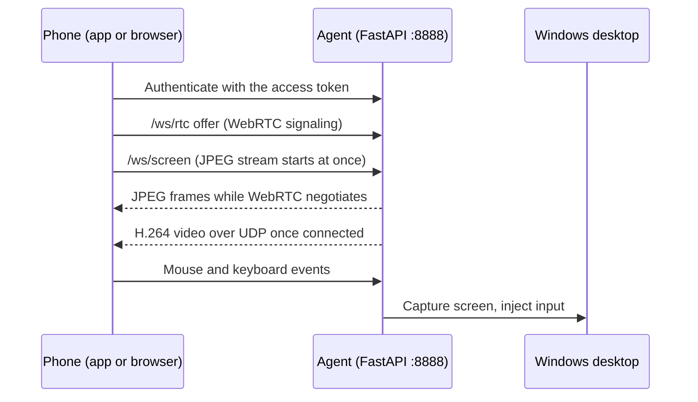

<div align="center">

# Repository Architecture Guide

The current source tree, runtime paths, APIs, security boundaries, tests and build workflows.

[← Project README](../README.md)

</div>

---

**On this page:** [Layout](#project-layout) · [Runtime flow](#runtime-flow) · [HTTP API](#http-api) · [Transports](#live-screen-and-input-transports) · [WebRTC protocol](#webrtc-and-stream-protocol) · [Security](#authentication-and-security) · [PIN lock](#pin-lock-design) · [Configuration](#configuration) · [Scripts](#windows-scripts) · [Clients](#frontend-and-android-client) · [Tests and CI](#tests-and-ci) · [Limitations](#known-limitations)

## Project layout

```text
.
├── backend/app/             FastAPI service and Windows desktop control
│   ├── main.py              HTTP routes, WebSocket routes, app lifecycle
│   ├── config.py            Environment configuration and validation
│   ├── security.py          Bearer-token auth and failed-login lockout
│   ├── monitor.py           CPU, memory, disk, network and uptime
│   ├── control.py           Windows lock, sleep, restart and shutdown
│   ├── pinlock.py           Persistent PIN-lock state (lock_state.json)
│   ├── screen.py            Capture, JPEG stream, pointer and input
│   ├── webrtc.py            WebRTC signaling, video track and data channels
│   └── webrtc_encoder.py    Low-latency H.264 encoder selection
├── backend/tests/           API, PIN lock, lock overlay, screen, input and WebRTC tests
├── frontend/                React + TypeScript + Vite web dashboard
├── android/                 Kotlin + Jetpack Compose Android client
├── lock_overlay.py          Full-screen PIN lock (single instance, own log, focus and hook handling)
├── run_agent.py             Entry point of the packaged RemotePCControl.exe
├── scripts/                 Windows setup, startup, tunnel, autostart, lock-screen and firewall scripts
├── installer/               Inno Setup installer definition
├── tools/wol_sender.py      Standalone Wake-on-LAN magic-packet utility
├── tests/                   Wake-on-LAN packet tests
├── docs/                    ARCHITECTURE.md (this file)
├── assets/                  README banner
├── .github/workflows/       CI, Android APK and Windows installer workflows
├── README.md                Install, run, connect, configure, troubleshoot
├── .env.example             Supported configuration settings
└── pyproject.toml           Python dependencies and pytest configuration
```

## Runtime flow



1. `scripts/setup.ps1` creates `.venv`, installs the Python package, builds the frontend, copies the dashboard into `backend/app/static/`, and creates `.env` with a random token.
2. `scripts/start.ps1` launches Uvicorn on port **8888**. If `QUICK_TUNNEL=1`, it can launch a Cloudflare quick tunnel and optionally publish its URL to a secret GitHub Gist.
3. The web dashboard or Android app authenticates against the FastAPI service.
4. The Android app starts JPEG/WebSocket streaming immediately while attempting WebRTC. When WebRTC video is decoded, it switches to WebRTC and closes the JPEG stream.
5. Mouse and keyboard events travel through the input WebSocket or WebRTC data channels.

> [!NOTE]
> Run the agent as the Windows user signed in to the desktop you want to control. It cannot control the secure sign-in desktop or UAC prompts.

## HTTP API

All endpoints except the health check require `Authorization: Bearer <REMOTE_PC_TOKEN>`.

| Method | Endpoint | Purpose |
|---|---|---|
| GET | `/api/health` | Public liveness check |
| GET | `/api/v1/status` | System status and usage metrics |
| GET | `/api/v1/metrics` | System metrics snapshot |
| POST | `/api/v1/control/lock` | Lock the PC. **PIN lock** (`"mode":"pin"`) when a PIN is set, otherwise Windows lock (`"mode":"windows"`). `REMOTE_PC_LOCK_BUTTON=windows` forces the Windows lock |
| POST | `/api/v1/control/sleep` | Request sleep |
| POST | `/api/v1/control/restart` | Restart; requires `{"confirm":true}` |
| POST | `/api/v1/control/shutdown` | Shutdown; requires `{"confirm":true}` |
| GET | `/api/v1/lock/status` | `{"locked": bool, "pin_set": bool}` |
| POST | `/api/v1/lock/pin` | Set or change the PC-side unlock PIN (4-12 digits); body `{"pin":"1234"}` |
| POST | `/api/v1/lock/lock` | Engage the persistent PIN lock (requires a PIN already set) |
| POST | `/api/v1/lock/unlock` | Release the PIN lock (the token already authenticates the app) |
| GET | `/api/v1/wol/status` | Reports Wake-on-LAN as unconfigured |
| POST | `/api/v1/wol/wake` | Returns HTTP 501 until an authenticated LAN relay is configured |

The dashboard is served from `backend/app/static/` after the frontend is built. If the lock state file cannot be read or written, the lock routes answer HTTP 503 instead of guessing.

## Live screen and input transports

| Endpoint | Transport | Role |
|---|---|---|
| `/ws/rtc` | WebSocket signaling | Exchanges WebRTC offers/answers, ICE candidates and connection state |
| WebRTC media | H.264 over UDP when a direct route is available | Low-latency video; old frames can be dropped instead of queued |
| WebRTC data channels | `input` and `control` | Pointer events, clicks, keyboard, text, cursor updates and live configuration |
| `/ws/screen` | JPEG frames over WebSocket | Fallback with acknowledgements, flow control, adaptive quality and resolution |
| `/ws/input` | JSON over WebSocket | Mouse, trackpad, keyboard, text input and cursor updates |

WebRTC can use NVIDIA NVENC, Intel QSV or AMD AMF hardware encoding; otherwise it falls back to libx264. The WebSocket stream remains available when WebRTC is disabled or cannot deliver video. A Cloudflare quick tunnel carries HTTP/WebSocket signaling but not direct UDP media; use LAN/Tailscale or configure TURN when needed. Protocol details: [WebRTC and stream protocol](#webrtc-and-stream-protocol).

## WebRTC and stream protocol

### JPEG stream quality (`/ws/screen`)

The `.env` values are only the *starting* values of every `/ws/screen` connection. A client can change them at any time while streaming:

```json
{"type":"config","max_width":1920,"fps":15,"quality":70}
```

All fields are optional. `max_width` is `0` (native) or 320-3840, `fps` is 1-60, `quality` is JPEG 25-90; out-of-range numbers are clamped and unusable values ignored. Settings are per connection. The server answers with `{"type":"screen","width":W,"height":H,"max_width":..,"fps":..,"quality":..}` (the values now in effect) followed by a new frame. Frames are never upscaled.

- **Sharp mode.** From JPEG quality 85 up the server downscales with Lanczos and keeps full-resolution colour (4:4:4 instead of 4:2:0). Frames get bigger, which the flow control absorbs on a fast link. The Native preset uses it.
- **Motion quality.** While the picture keeps changing, frames are sent at `REMOTE_PC_MOTION_QUALITY` percent of the JPEG quality and `REMOTE_PC_MOTION_WIDTH` percent of the width (both `100` = off). After about 0.2 s of rest one full-quality frame follows.
- **Fast capture.** `setup.ps1` tries to install the optional `dxcam` package (DXGI capture, several times faster than `mss`). If it is missing or does not work, the server prints one line and keeps using `mss`; `REMOTE_PC_CAPTURE=mss` forces it.

### WebRTC (low latency)

The JPEG stream sends one picture per frame over a TCP WebSocket, so one slow packet delays everything behind it. WebRTC sends H.264 over UDP (old frames are dropped, not queued) and carries mouse and keyboard input on data channels.

- When the user taps *Start screen*, the Android app opens `/ws/rtc` with the same token. That socket only exchanges the connection offer; video and input then travel directly between phone and PC.
- The JPEG stream starts at the same moment, so a picture appears from the first second. Once WebRTC video is really decoded the app switches to it and closes the JPEG stream. If WebRTC has not delivered video within about 20 seconds, or the PC reports it unavailable, the app keeps the WebSocket stream and shows a notice. A network drop under 5 seconds does not end a working session.
- The PC encodes on the GPU when it can (`nvenc`, `qsv`, `amf`), otherwise libx264 (`ultrafast`, `zerolatency`, no B-frames). A hardware encoder that does not work is skipped automatically.
- Input uses two data channels with the same JSON messages as `/ws/input`: `input` (unordered, no retransmits) for pointer moves and `control` (reliable) for clicks, keys, scroll, hotkeys and text.
- The live bitrate follows the receiver's estimate but never goes below the *floor*: 1 Mbit/s, or one sixth of the limit when that is higher, and never below the limit itself if that is lower.

| Network | Result |
|---|---|
| Same Wi-Fi / LAN | Direct UDP, lowest latency (about 50 ms or less) |
| Tailscale (phone and PC) | Direct UDP through the Tailscale addresses |
| Internet, both sides reachable with STUN | Direct UDP after NAT punch-through |
| Mobile data behind CGNAT / strict firewall | Needs a TURN relay, otherwise WebSocket fallback |
| Cloudflare quick tunnel only | TCP only: signaling works, video does not; falls back to WebSocket |

### Signaling protocol (for other clients)

`/ws/rtc` uses the same first message as the other sockets, `{"token":"..."}`, then JSON:

1. The PC sends `{"type":"ready","ice_servers":[...]}`.
2. The client sends `{"type":"offer","sdp":"..."}` (receive-only video plus data channels `input` and `control`) and gets `{"type":"answer","sdp":"..."}`.
3. Trickle candidates go both ways as `{"type":"candidate","candidate":{"candidate":"...","sdpMid":"0","sdpMLineIndex":0}}`.
4. `{"type":"unavailable","reason":"..."}` means: use `/ws/screen`.
5. Over the `control` channel `{"type":"config","max_width":1280,"fps":30,"bitrate":3000,"cursor":true}` changes the video live (bitrate in kbit/s).

More detail is in the header of `backend/app/webrtc.py`.

## Authentication and security

- HTTP requests use `Authorization: Bearer <REMOTE_PC_TOKEN>`; WebSocket clients send the token before using the socket.
- `backend/app/security.py` compares tokens in constant time.
- A client is locked out after **8** failed attempts within **5 minutes**. A global guard also blocks all authentication after **40** failed attempts within **10 minutes**, even if requests rotate client IPs. Behind a Cloudflare tunnel the client is identified by the `CF-Connecting-IP` header.
- Setup generates a long random token. The application accepts a minimum of 4 characters for compatibility, but a unique token of at least 12 characters is strongly recommended.
- `.env` is ignored by Git. Never commit it or share the token or tunnel URL.
- Never port-forward TCP 8888 directly to the public internet. Prefer Tailscale or private Wi-Fi, or Cloudflare Access for a named hostname.
- Android encrypts the saved token using an Android Keystore key. **Log out** clears the saved token.

## PIN lock design

The PIN lock is two independent processes sharing one file:

| Part | Role |
|---|---|
| `backend/app/pinlock.py` | Owns `lock_state.json` (locked flag, salted PIN hash, failure counter). Reads and writes take an OS-level file lock and writes are atomic, so the API and the overlay never see a half-written file |
| `lock_overlay.py` | Separate process that polls the file every second and shows or hides a full-screen PIN window. Works even when the server is not running, and again right after Windows boots |
| `scripts/install-lock-overlay.ps1` | Registers the single scheduled task `RemotePCControlLock` (sign-in trigger plus a one-minute watchdog; `IgnoreNew` and a per-session mutex prevent duplicate windows) |

Rules: PINs are 4-12 digits; five wrong PINs at the PC start a 60-second cool-down; an unreadable state file never counts as "unlocked"; no PIN, hash or salt is ever logged. The overlay logs to `%LOCALAPPDATA%\RemotePCControl\lock_overlay.log`. The state file path can be overridden with `REMOTE_PC_LOCK_STATE`. The manual test checklist is in the [README](../README.md#-pin-lock).

## Configuration

The full settings list with defaults and ranges is in the [README](../README.md#-configuration); the annotated template is [`.env.example`](../.env.example).

| Group | Variables | Purpose |
|---|---|---|
| Server | `REMOTE_PC_TOKEN`, `REMOTE_PC_HOST`, `REMOTE_PC_PORT` | Authentication and listen settings (host and port are used by `run_agent.py` only; `start.ps1` binds `0.0.0.0:8888`) |
| JPEG/WebSocket stream | `REMOTE_PC_FPS`, `REMOTE_PC_JPEG_QUALITY`, `REMOTE_PC_MAX_WIDTH` | Initial frame rate, JPEG quality and width |
| Adaptive streaming | `REMOTE_PC_LATENCY_FIRST`, `REMOTE_PC_MOTION_QUALITY`, `REMOTE_PC_MOTION_WIDTH` | Reduce queued data and motion-frame size on slow links |
| Capture | `REMOTE_PC_CAPTURE`, `REMOTE_PC_SHOW_CURSOR` | DXGI/mss capture selection and pointer overlay |
| WebRTC | `REMOTE_PC_WEBRTC`, `REMOTE_PC_RTC_FPS`, `REMOTE_PC_RTC_BITRATE`, `REMOTE_PC_RTC_ENCODER` | Video enablement, limits and encoder |
| NAT traversal | `REMOTE_PC_STUN_URL`, `REMOTE_PC_TURN_URL`, `REMOTE_PC_TURN_USER`, `REMOTE_PC_TURN_PASS` | ICE/STUN/TURN connectivity |
| PIN lock | `REMOTE_PC_LOCK_BUTTON`, `REMOTE_PC_LOCK_STATE` | Which lock the Lock button uses; state file location |
| Tunnel (script only) | `QUICK_TUNNEL`, `GIST_TOKEN`, `GIST_ID` | Read by `start.ps1` to start a quick tunnel and publish its link |

Restart `scripts/start.ps1` after changing `.env`. Stream quality can also be adjusted by the client while connected.

## Windows scripts

| File | Purpose |
|---|---|
| `scripts/setup.ps1` | Install dependencies, build the dashboard, create or update `.env`, offer `GIST_TOKEN`, attempt the Tailscale-only firewall rule |
| `scripts/start.ps1` | Stop an older copy of this server, start Uvicorn; optionally start a quick tunnel and publish its link to a Gist |
| `scripts/start-tunnel.ps1` | Run a temporary Cloudflare quick tunnel |
| `scripts/set-password.ps1` | Change `REMOTE_PC_TOKEN` in `.env` |
| `scripts/set-pin.ps1` | Set or change the PC-side unlock PIN (read from a hidden prompt, passed to Python on stdin) |
| `scripts/install-autostart.ps1` | Install or remove (`-Remove`) the hidden sign-in task `RemotePCControl`; `-Admin` for the highest run level |
| `scripts/autostart-hidden.vbs`, `scripts/autostart-runner.ps1` | Launch the runner hidden, wait for the network, restart the server if it exits |
| `scripts/install-lock-overlay.ps1` | Install or remove (`-Remove`) the single sign-in task `RemotePCControlLock` |
| `scripts/configure-installed.ps1` | Create initial `.env` for the packaged executable |
| `scripts/remove-firewall.ps1` | Remove the setup-created Tailscale firewall rule |

## Frontend and Android client

- **Web:** `frontend/src/App.tsx` provides login, status/metrics, power controls and WebSocket setup. `RemoteScreen.tsx` implements touch gestures, keyboard shortcuts and screen interaction. `style.css` contains the responsive dark dashboard.
- **Android:** `MainActivity.kt` handles navigation; `ConnectScreen.kt`, `DashboardScreen.kt` and `SessionScreen.kt` are the main screens. `RemoteController.kt` manages API and session state. `Rtc.kt` implements WebRTC; `SecureStore.kt` encrypts credentials; `Trackpad.kt` handles trackpad gestures.
- Android settings: min SDK 26, target/compile SDK 35, JDK 17, Kotlin 2.1 and Jetpack Compose. CI produces a debug APK for personal use, not a Play Store release.

## Tests and CI

Run tests from the repository root:

```powershell
.\.venv\Scripts\python.exe -m pytest backend/tests tests -q
```

Build the web dashboard:

```powershell
cd frontend
npm install
npm run build
```

| Test file | Covers |
|---|---|
| `backend/tests/test_api.py` | Authentication, lockout and API behaviour |
| `backend/tests/test_pinlock.py` | PIN-lock state and its lock/unlock behaviour |
| `backend/tests/test_lock_overlay.py` | Overlay logic and Tk event handling (Linux/Xvfb and Windows CI) |
| `backend/tests/test_screen_config.py` | Screen configuration and frame flow control |
| `backend/tests/test_screen_input.py` | Pointer and keyboard input |
| `backend/tests/test_webrtc.py` | WebRTC signaling, ICE configuration, data channels, video tracks, encoder fallback |
| `tests/test_wol_packet.py` | Wake-on-LAN magic-packet format |

| Workflow | Trigger and output |
|---|---|
| `.github/workflows/ci.yml` | Push, pull request or manual run (Windows runner): Python tests, a check that `install-lock-overlay.ps1` is idempotent (informational), and the frontend build |
| `.github/workflows/android-build.yml` | Push to `main` or pull request touching `android/`, or manual run: builds a debug APK, uploads the artifact (14 days) and, outside pull requests, publishes a release `android-build-<run number>` |
| `.github/workflows/windows-build.yml` | Manual run or `v*` tag: packages `RemotePCControl.exe` with PyInstaller and builds the Inno Setup installer |
| `scripts/publish-release.sh` | Used by both build workflows: one GitHub release per commit (`build-<sha>`) that always holds the newest Windows installer and the newest Android APK (the file this build did not make is carried over from the last release that has it) |

## Known limitations

- Wake-on-LAN API support is unconfigured. `tools/wol_sender.py` sends a magic packet from a device already on the target LAN, but the PC agent cannot wake itself. Waking over mobile data needs a separately authenticated, always-on LAN relay.
- The agent cannot control Windows sign-in, the UAC secure desktop or other protected sessions.
- The PIN lock is an ordinary desktop window: it cannot block Ctrl+Alt+Delete and is not a substitute for the Windows account password.
- Cloudflare Access email/OTP login works in a browser; the Android app cannot complete that browser flow.
- WebRTC requires a direct UDP path or TURN. A quick tunnel alone falls back to WebSocket/JPEG.
- The CI Android APK is a debug build intended for personal use.
